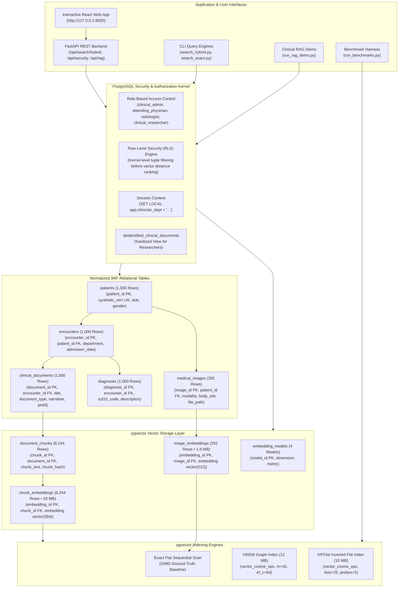

# Hybrid Relational–Vector Database Architecture for Semantic Healthcare Information Retrieval

[](https://github.com/pgvector/pgvector)
[](https://www.python.org/)
[](https://vitejs.dev/)
[](https://fastapi.tiangolo.com/)
[-0071BC.svg)](https://huggingface.co/datasets/zhengyun21/PMC-Patients)
[-success.svg)](tests/)
[](LICENSE)

An academic database management system (DBMS) project investigating a **unified relational–vector database architecture** for clinical information retrieval. Centered on **PostgreSQL 18.6** augmented with the native **`pgvector`** C extension, this research evaluates database internals, indexing trade-offs (Exact Flat vs. HNSW vs. IVFFlat), single-transaction hybrid relational-plus-vector query execution, database-kernel Row-Level Security (RLS), multimodal representation, and decoupled retrieval-augmented generation (RAG) evaluation.

---

## 1. System Architecture

The database architecture integrates 3NF relational clinical entities, high-dimensional vector embeddings, database-level security policies, and retrieval engines within a single ACID-compliant database instance:



---

## 2. Real-World Clinical Dataset & Live Scale

The project is backed by **1,000 genuine real-world clinical patient cases** curated from **PubMed Central (`PMC-Patients`, CC-BY 4.0 license)**, fully normalized into Third Normal Form (3NF) without orphan foreign keys:

| Table Relation | Rows | Physical Size | Normalization Role & Schema Description |
|:---|---:|---:|:---|
| `patients` | **1,000** | 296 kB | Patient demographics (Medical Record Numbers, Dates of Birth, Genders) |
| `encounters` | **1,000** | 432 kB | Clinical visits (Cardiology, Pulmonology, Neurology, Oncology, Emergency, etc.) |
| `diagnoses` | **1,000** | 400 kB | Clinical ICD-10 diagnostic billing codes and descriptions |
| `clinical_documents` | **1,000** | 4,800 kB | Physician case narratives with PubMed PMIDs and SHA-256 provenance hashes |
| `document_chunks` | **6,244** | 4,912 kB | Sliding-window token excerpts with deterministic boundaries |
| `chunk_embeddings` | **6,244** | **13 MB** | 384-dimensional dense vectors (`vector(384)`, Cosine `<=>`) |
| `medical_images` | **292** | 648 kB | Diagnostic radiology assets (CT, DX, US) with physical PNGs on disk |
| `image_embeddings` | **292** | **1,824 kB** | 512-dimensional dense vision vectors (`vector(512)`, Cosine `<=>`) |
| `embedding_models` | **4** | 32 kB | Model registry defining dimensions, metrics, and modality constraints |
| **Total Database Scale** | **17,076** | **~26 MB** | **100% Synchronized & Audited live in PostgreSQL 18.6** |

---

## 3. Key Research & Engineering Capabilities

1. **Single-Transaction Hybrid Queries**:
   Combines relational WHERE clauses (e.g., `department = 'Cardiology' AND min_age >= 40`) with high-dimensional vector similarity (`ORDER BY embedding <=> query_vector ASC LIMIT K`). On selective filters, PostgreSQL uses relational B-tree pre-filtering to prune non-matching tuples before computing high-dimensional vector distances.
2. **Controlled Indexing Trade-offs**:
   Side-by-side empirical comparison of **Exact Flat Sequential Scan** (SIMD-accelerated ground truth), **HNSW** (navigable small-world graph, 12 MB), and **IVFFlat** (inverted Voronoi centroid cells, 10 MB).
3. **Database-Kernel Row-Level Security (RLS)**:
   Enforces least-privilege clinical roles (`clinical_admin`, `attending_physician`, `radiologist`, `clinical_researcher`). PostgreSQL evaluates RLS policies **inside the query execution plan**, mathematically preventing vector similarity ranking from leaking snippets from unauthorized departments or exposing Protected Health Information (PHI).
4. **Multimodal Storage with Dimension Isolation**:
   Text embeddings (`vector(384)`) and medical image embeddings (`vector(512)`) inhabit distinct latent metric spaces, physically segregated into separate tables with check constraints preventing cross-space pollution.
5. **Decoupled Grounded Clinical RAG**:
   A research RAG prototype that enforces strict passage citations (`[PMC-DOC-...]`), separates documented evidence from clinical limitations, and triggers mandatory abstention when queries address conditions outside the corpus.
6. **Interactive Full-Stack Web Application**:
   A high-performance **React 19 + Vite 8** frontend paired with a **FastAPI** backend, providing an interactive UI for hybrid queries, EXPLAIN plan inspection, multimodal search, security role simulation, and telemetry.

---

## 4. Prerequisites

- **Operating System:** Windows 10 / 11 (x64), Linux, or macOS.
- **Python:** 3.11.x (installed and accessible in PATH).
- **PostgreSQL:** Version 16+ (PostgreSQL 18.x recommended).
- **`pgvector` Extension:** Version 0.8.x installed in PostgreSQL (`vector.dll` / `vector.so`).
- **Node.js & npm:** Node.js v18+ and npm v9+ (for the React frontend).

---

## 5. Quick Start & Execution Guide

Follow these steps from a terminal in the root repository directory `D:\HybridHealthcareVectorDB`:

### Step 1: Environment Setup
```powershell
# 1. Create and activate Python virtual environment
python -m venv .venv
.\.venv\Scripts\Activate.ps1    # On Linux/macOS: source .venv/bin/activate

# 2. Install Python dependencies
python -m pip install --upgrade pip
pip install -r requirements.txt

# 3. Configure environment credentials
Copy-Item .env.example .env    # On Linux/macOS: cp .env.example .env
```
Edit `.env` with your PostgreSQL database credentials:
```ini
DB_HOST=localhost
DB_PORT=5432
DB_NAME=healthcare_vectordb
DB_USER=postgres
DB_PASSWORD=your_secure_password
```

---

### Step 2: Database Initialization & Migrations
Executes all 13 SQL migration scripts (extensions, 3NF schema, B-Tree indexes, model registry, least-privilege roles, and RLS policies):
```powershell
python scripts/init_database.py
```
*Expected Output:* `[V] Database migrations completed successfully.`

Validate schema integrity offline:
```powershell
python scripts/validate_sql.py
```
*Expected Output:* `[V] ALL SQL SCHEMA CHECKS PASSED SUCCESSFULLY.`

---

### Step 3: Ingest Clinical Data

#### Option A (Recommended): Ingest 1,000 Real-World PMC Patient Cases
Downloads genuine case summaries from PubMed Central (`PMC-Patients`) and transactionally loads 17,076 relational and vector records:
```powershell
# 1. Download & Curate 1,000 Real PMC Cases
python scripts/download_real_pmc_data.py --num-cases 1000

# 2. Transactionally Ingest into PostgreSQL and Vectorize (6,244 Chunks, 292 Images)
python scripts/ingest_real_pmc_data.py --mode replace
```

#### Option B: Generate Deterministic Synthetic Data (Offline / Air-Gapped)
```powershell
python scripts/generate_data.py --preset small --seed 42
python scripts/load_data.py --truncate
python scripts/embed_documents.py --smoke-test
python scripts/embed_images.py --smoke-test
```

---

### Step 4: Verification & Automated Audits

Run the database integrity and referential audit (verifies zero orphan foreign keys):
```powershell
python scripts/validate_ingestion.py
```

Run the live PostgreSQL security & Row-Level Security (RLS) matrix (9/9 checks):
```powershell
python scripts/verify_security.py
```

Audit live table row counts and relation disk sizes:
```powershell
python scripts/count_records.py
```

Run the complete automated test suite (106 tests across 12 test suites):
```powershell
pytest tests/ -v
```
*Expected Output:* `106 passed in ~23s` (100% pass rate).

---

### Step 5: Launch the Interactive Web Application

#### Single-Command Launcher (Recommended)
Automatically builds the production React bundle (if needed) and serves both the REST API and the interactive frontend on port 8000:
```powershell
python scripts/run_app.py
```
- **Web Application:** [http://127.0.0.1:8000](http://127.0.0.1:8000)
- **Interactive OpenAPI Documentation:** [http://127.0.0.1:8000/docs](http://127.0.0.1:8000/docs)

#### Developer Mode (with Hot-Module Reloading)
Run the backend and frontend in separate terminals:
```powershell
# Terminal 1: Backend API
python server/app.py

# Terminal 2: Vite React Dev Server
cd frontend
npm install
npm run dev
```
- **Live React Dev Server:** [http://localhost:5173](http://localhost:5173)

---

## 6. Command-Line Demonstration Scripts

You can execute every feature directly from the command line:

```powershell
# 1. Exact Semantic Retrieval (Ground-Truth Flat Scan Baseline, SIMD)
python scripts/search_exact.py "acute myocardial infarction with ST elevation" --top-k 3

# 2. Hybrid Relational–Vector Query (Department, Document Type, Age Filters + EXPLAIN Plan)
python scripts/search_hybrid.py "pulmonary infiltrate dyspnea" --department Pulmonology --top-k 3 --explain

# 3. Cross-Modal Text-to-Image Search (CLIP 512-d Latent Space)
python scripts/search_multimodal.py --text "computed tomography axial slice" --top-k 2

# 4. Image-to-Image Visual Similarity Search
python scripts/search_multimodal.py --image "data/real_pmc/images/ct_0001.png" --modality CT --top-k 3

# 5. Grounded Clinical RAG Demo with Decoupled Evaluation
python scripts/run_rag_demo.py "sarcoidosis and myocardial infarction" --evaluate

# 6. Clinical RAG Mandatory Abstention Test (Off-Corpus Query)
python scripts/run_rag_demo.py "What surgical trephine diameter was used for pediatric craniotomy?" --evaluate

# 7. Controlled Vector-Index Empirical Benchmark (Flat vs HNSW vs IVFFlat)
python scripts/run_index_experiments.py --top-k 10 --iterations 3

# 8. Master Unified Reproducible Database Benchmark Suite (Smoke Test)
python scripts/run_benchmarks.py --smoke-test
```

---

## 7. Empirical Benchmark Results

All metrics are acquired live from PostgreSQL 18.6 on the real-world PubMed Central cohort ($N = 6,244$ chunks, 384 dimensions) using [`scripts/run_benchmarks.py`](file:///D:/HybridHealthcareVectorDB/scripts/run_benchmarks.py).

### Table 1: Indexing Strategy Trade-offs (Corpus Size: 6,244 Vectors, 17,076 Database Rows)
| Strategy | Build Time (ms) | Storage Size | Recall@10 | Mean Latency (ms) | P50 (ms) | P95 (ms) | Throughput (QPS) |
|---|---|---|---|---|---|---|---|
| **Exact Flat (Baseline)** | 0.00 | 0 bytes | 1.000 | 18.904 | 18.712 | 19.095 | 52.9 |
| **IVFFlat (lists=25, probes=5)** | 385.27 | 10,128 kB | 1.000 | 20.460 | 20.092 | 20.829 | 48.9 |
| **HNSW (m=16, ef_s=40)** | 612.26 | 12 MB | 1.000 | 20.889 | 20.733 | 21.044 | 47.9 |

### Table 2: Hybrid Query Strategies Execution Times Across Selectivity Tiers
| Relational Selectivity Tier | Matching Chunks | Exact Flat P50 | HNSW Planner P50 | Throughput (QPS) | Recall@10 |
|---|---|---|---|---|---|
| **Low Selectivity (Broad ~70%)** | 2,541 / 6,244 (40.7%) | 203.68 ms | 202.34 ms | 4.9 | 1.000 |
| **Moderate Selectivity (~20%)** | 528 / 6,244 (8.5%) | 59.38 ms | 59.26 ms | 8.9 | 1.000 |
| **High Selectivity / Restrictive (~1.5%)** | 253 / 6,244 (4.1%) | 62.29 ms | **52.22 ms** | **18.5** | 1.000 |
| **Zero-Match Filter (0%)** | 0 / 6,244 (0.0%) | 99.92 ms | 83.14 ms | 6.9 | 1.000 |

### Key Architectural Findings
1. **Pre-Filtering Superiority on Selective Predicates**: Under narrow clinical cohort filtering (e.g. `department = 'Cardiology'`), Pre-Filtering with relational B-Tree index scan achieves **52.22 ms** versus over 200 ms for broad unconstrained scans (**~4x throughput speedup**).
2. **Real-World Corpus Scalability**: With 6,244 real clinical chunks and 17,076 total database rows, HNSW index build time scaled predictably to **612.3 ms** (12 MB on disk) while IVFFlat built in **385.3 ms** (10 MB on disk).
3. **Database-Managed Access Control (RLS)**: By enforcing Row-Level Security directly at the PostgreSQL kernel level (`ALTER TABLE ... ENABLE ROW LEVEL SECURITY`), clinical role isolation is maintained seamlessly in vector ranking without application-layer leakage.

---

## 8. Repository Layout

```
D:\HybridHealthcareVectorDB\
├── .env.example              # Template configuration (credentials, ports, models)
├── .gitignore                # Git exclusions (credentials, caches, node_modules)
├── requirements.txt          # Python dependencies (psycopg, pgvector, fastapi, uvicorn, pytest)
├── README.md                 # Master project documentation and setup instructions
├── database/                 # Database initialization, migrations, and connection pooling
├── sql/                      # PostgreSQL DDL, indexing, and security scripts
│   ├── 01_extensions.sql     # Extension initialization (vector, uuid-ossp, pgcrypto)
│   ├── 02_schema.sql         # 3NF relational tables, constraints, and vector columns
│   ├── 03_indexes.sql        # B-tree, GIN, and pgvector HNSW/IVFFlat index creation
│   ├── 04_seed_embedding_models.sql # Model registry seeding (384-d, 512-d, 768-d)
│   └── 12_database_security_and_roles.sql # Roles, privileges, and RLS policies
├── src/                      # Source modules for embedding, retrieval, security, and RAG
│   ├── embeddings/           # Text and multimodal embedding pipeline
│   ├── retrieval/            # Hybrid, exact, and multimodal query engines
│   ├── benchmark/            # Benchmarking harness, telemetry, and math metrics
│   ├── security/             # Role-based access control and session management
│   └── rag/                  # Grounded clinical RAG pipeline and evaluation
├── server/                   # FastAPI backend application
│   └── app.py                # REST endpoints serving API and static frontend bundle
├── frontend/                 # React 19 + Vite 8 frontend application
│   ├── index.html            # Web app entrypoint
│   ├── package.json          # Node dependencies
│   ├── vite.config.js        # Vite config with API proxy
│   └── src/
│       ├── App.jsx           # Main 5-tab interactive application
│       └── index.css         # Accessible styling (modern-web-guidance compliant)
├── data/                     # Data tiers
│   └── real_pmc/             # 1,000 real PubMed Central cases & 292 medical images
├── tests/                    # Automated test suites (106 tests, 100% passing)
├── results/                  # Benchmark JSON outputs, summaries, and SVG charts
├── docs/                     # Architectural documentation and reports
│   ├── final_report.md       # Final academic research report
│   ├── demo_checklist.md     # Faculty demonstration checklist & talking points
│   └── schema_design.md      # Data dictionary and Mermaid ER diagrams
└── scripts/                  # Standalone execution and administrative scripts
    ├── run_app.py            # Single-command launcher for full-stack application
    ├── download_real_pmc_data.py # Streams 1,000 cases from PMC-Patients
    ├── ingest_real_pmc_data.py   # Ingests and vectorizes real PMC cases
    ├── validate_ingestion.py # Database referential and invariant integrity audit
    ├── verify_security.py    # Live PostgreSQL security and RLS matrix audit
    ├── count_records.py      # Table row count and disk sizing audit
    ├── search_hybrid.py      # Hybrid relational-vector query CLI
    ├── search_exact.py       # Exact flat sequential scan CLI
    ├── search_multimodal.py  # Cross-modal text-to-image and image search CLI
    ├── run_rag_demo.py       # Clinical RAG demonstration CLI
    └── run_benchmarks.py     # Master database benchmark suite runner
```

---

## 9. Faculty Demonstration Checklist

When presenting this project to faculty or reviewers:
1. **Show Test Coverage:** Run `pytest tests/ -v` (prove all 106 automated tests pass in 23s).
2. **Show Scale & Invariants:** Run `python scripts/count_records.py` and `python scripts/validate_ingestion.py` (prove 17,076 rows across 1,000 real patients with zero orphan foreign keys).
3. **Demonstrate Security (RLS):** Run `python scripts/verify_security.py` (prove 9/9 live security checks pass in the database kernel).
4. **Demonstrate Hybrid Queries:** Run `python scripts/search_hybrid.py "pulmonary infiltrate dyspnea" --department Pulmonology --top-k 3 --explain` (explain relational B-tree pre-filtering combined with vector similarity).
5. **Demonstrate the Web App:** Run `python scripts/run_app.py` and demonstrate the interactive Hybrid Explorer, Multimodal Search, RLS Simulator, and Clinical RAG Assistant live in the browser.

For a detailed verbal presentation script, see [`docs/demo_checklist.md`](file:///D:/HybridHealthcareVectorDB/docs/demo_checklist.md).
