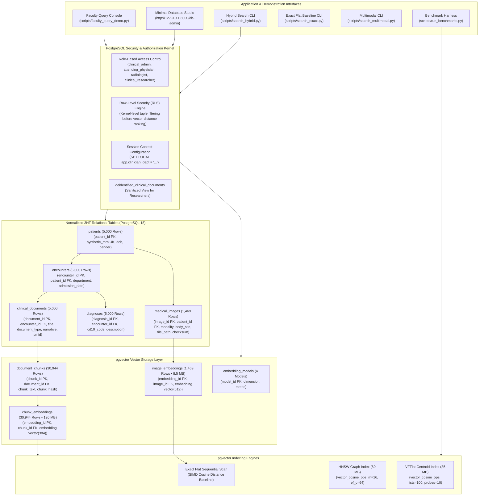

# Hybrid Relational–Vector Database Architecture for Semantic Healthcare Information Retrieval

[](https://github.com/pgvector/pgvector)
[](https://www.python.org/)
[](README.md)
[-0071BC.svg)](https://huggingface.co/datasets/zhengyun21/PMC-Patients)
[-blueviolet.svg)](scripts/count_records.py)
[-success.svg)](tests/)
[-brightgreen.svg)](scripts/verify_security.py)
[](LICENSE)

An academic database management system (DBMS) research project investigating a **unified relational–vector database architecture** for clinical information retrieval. Centered on **PostgreSQL 18** augmented with the native C extension **`pgvector` (v0.8.6+)**, this work evaluates database engine internals, indexing trade-offs (Exact SIMD Flat vs. HNSW vs. IVFFlat), single-transaction hybrid relational-plus-vector query execution, database-kernel Row-Level Security (RLS), multimodal clinical representation, and decoupled retrieval-augmented generation (RAG) evaluation.

---

## 1. System Architecture

The architecture unifies normalized 3NF relational clinical entities, dense vector embeddings, database-level security policies, and retrieval engines within a single ACID-compliant PostgreSQL database instance:



---

## 2. Real-World Clinical Dataset & Live Scale

The database is populated with **5,000 genuine real-world clinical patient cases** curated from **PubMed Central (`PMC-Patients`, CC-BY 4.0 license)**, fully normalized into Third Normal Form (3NF) without orphan foreign keys:

| Table Relation | Rows | Physical Size | Normalization Role & Schema Description |
|:---|---:|---:|:---|
| `patients` | **5,000** | 1,112 kB | Patient demographics (Medical Record Numbers, Dates of Birth, Genders) |
| `encounters` | **5,000** | 1,648 kB | Clinical encounters (Cardiology, Pulmonology, Neurology, Oncology, Emergency, etc.) |
| `diagnoses` | **5,000** | 1,520 kB | ICD-10 diagnostic billing codes and clinical descriptions |
| `clinical_documents` | **5,000** | 17 MB | Full physician case reports with PMIDs and cryptographic provenance hashes |
| `document_chunks` | **30,944** | 23 MB | Token-bounded passage chunks with deterministic chunk boundaries |
| `chunk_embeddings` | **30,944** | **126 MB** | 384-dimensional dense vectors (`vector(384)`, Cosine `<=>`, HNSW index) |
| `medical_images` | **1,469** | 2,320 kB | Multi-modal radiological assets (CT, DX, MRI, US) with SHA-256 verification |
| `image_embeddings` | **1,469** | **8,528 kB** | 512-dimensional dense visual vectors (`vector(512)`, CLIP ViT-B/32) |
| `embedding_models` | **4** | 64 kB | Model registry cataloging dimensions, metrics, and modality separation rules |
| **Total Database Scale** | **84,830** | **~180 MB** | **100% Synchronized & Audited live in PostgreSQL 18.6** |

---

## 3. Key Research & Engineering Capabilities

1. **Single-Transaction Hybrid Queries**:
   Combines relational SQL predicates (e.g., `department = 'Cardiology' AND min_age >= 40`) with high-dimensional vector distance ranking (`ORDER BY embedding <=> query_vector ASC LIMIT K`). On selective predicates, PostgreSQL leverages relational B-tree pre-filtering to eliminate non-matching rows before evaluating high-dimensional distances.
2. **Controlled Indexing Trade-offs**:
   Rigorous empirical evaluation comparing **Exact Flat Sequential Scan** (SIMD-accelerated ground truth), **HNSW** (Hierarchical Navigable Small World graph), and **IVFFlat** (Inverted File Flat with Voronoi cells).
3. **Database-Kernel Row-Level Security (RLS)**:
   Enforces clinical authorization policies (`clinical_admin`, `attending_physician`, `radiologist`, `clinical_researcher`) directly inside the PostgreSQL execution planner (`ALTER TABLE ... ENABLE ROW LEVEL SECURITY`), mathematically preventing vector nearest-neighbor ranking from leaking unauthorized clinical data.
4. **Multimodal Storage with Latent Space Isolation**:
   384-dimensional text vectors and 512-dimensional vision vectors inhabit strictly segregated tables, with PostgreSQL type constraints preventing cross-space vector distance corruption.
5. **Decoupled Grounded Clinical RAG**:
   Enforces strict token passage citations (`[PMC-DOC-...]`), isolates documented clinical evidence from model interpretation, and triggers mandatory abstention when queries address conditions absent from the corpus.

---

## 4. Platform & Hardware Prerequisites

This project is platform-agnostic and runs natively on **macOS (Apple Silicon M1/M2/M3/M4 & Intel)**, **Linux (Ubuntu/Debian/RHEL)**, and **Windows (10/11 x64)**.

- **Python:** Version 3.11.x
- **PostgreSQL:** Version 16, 17, or 18 (PostgreSQL 18 recommended)
- **`pgvector`:** Version 0.8.0 or newer (v0.8.6+ recommended)

### Platform-Specific PostgreSQL & pgvector Setup

#### macOS (Apple Silicon & Intel via Homebrew)
```bash
# 1. Install PostgreSQL 16/17/18 and pgvector
brew install postgresql@16 pgvector

# 2. Start PostgreSQL service
brew services start postgresql@16

# 3. Create the database
createdb healthcare_vectordb
```

#### Linux (Ubuntu / Debian)
```bash
# 1. Install PostgreSQL and development headers
sudo apt update && sudo apt install -y postgresql postgresql-contrib postgresql-server-dev-16

# 2. Install pgvector from official PGDG repository or source
sudo apt install -y postgresql-16-pgvector

# 3. Start PostgreSQL and create database
sudo systemctl start postgresql
sudo -u postgres createdb healthcare_vectordb
```

#### Windows (x64)
- Install PostgreSQL 16+ via EnterpriseDB installer.
- Install `pgvector` binaries into your PostgreSQL `bin/` and `share/` directories using `scripts/install_pgvector_admin.ps1`.

---

## 5. Quick Start & Execution Guide

### Step 1: Environment Setup

#### On macOS / Linux:
```bash
# 1. Clone repository and navigate to root
cd HybridHealthcareVectorDB

# 2. Create and activate Python 3.11 virtual environment
python3.11 -m venv .venv
source .venv/bin/activate

# 3. Install dependencies
pip install --upgrade pip
pip install -r requirements.txt

# 4. Configure environment credentials
cp .env.example .env
```

#### On Windows (PowerShell):
```powershell
python -m venv .venv
.\.venv\Scripts\Activate.ps1
python -m pip install --upgrade pip
pip install -r requirements.txt
Copy-Item .env.example .env
```

Configure your `.env` file with your local database credentials:
```ini
DB_HOST=localhost
DB_PORT=5432
DB_NAME=healthcare_vectordb
DB_USER=postgres
DB_PASSWORD=your_secure_password
```

---

### Step 2: Database Initialization & Migrations

Execute the migration harness to apply all 13 SQL migration scripts (extensions, 3NF schema, B-tree indexes, model registry, least-privilege roles, and RLS policies):

```bash
python scripts/init_database.py
```
*Expected Output:* `[V] Database migrations completed successfully.`

Validate schema integrity and constraints offline:
```bash
python scripts/validate_sql.py
```
*Expected Output:* `[V] ALL SQL SCHEMA CHECKS PASSED SUCCESSFULLY.`

---

### Step 3: Clinical Data Ingestion

#### Option A (Recommended): Ingest 5,000 Real-World PMC Patient Cases (84,830 Records)
```bash
# 1. Download and curate 5,000 Real PMC Cases
python scripts/download_real_pmc_data.py --num-cases 5000

# 2. Transactionally Ingest into PostgreSQL and Vectorize (30,944 Chunks, 1,469 Images)
python scripts/ingest_real_pmc_data.py --mode replace
```

#### Option B: Synthetic Deterministic Cohort Generation (Offline / Air-Gapped)
```bash
python scripts/generate_data.py --preset small --seed 42
python scripts/load_data.py --truncate
python scripts/embed_documents.py --smoke-test
python scripts/embed_images.py --smoke-test
```

---

### Step 4: Verification & Automated Audits

Run the referential integrity audit (validates 0 orphan foreign keys across all 5,000 cases):
```bash
python scripts/validate_ingestion.py
```

Run the live PostgreSQL security & Row-Level Security (RLS) matrix (9/9 checks):
```bash
python scripts/verify_security.py
```
*Expected Output:* `[V] ALL 9 AUTHORIZATION & SECURITY TESTS PASSED SUCCESSFULLY!`

Audit live table row counts and physical disk footprint:
```bash
python scripts/count_records.py
```

Run the complete regression test suite (106 tests across 12 test suites):
```bash
pytest tests/ -v
```
*Expected Output:* `106 passed in ~88s (100% pass rate)`

---

## 6. Faculty Demonstration Options

You can demonstrate the project to faculty or reviewers using two clean options:

### Option A: Interactive Faculty Terminal Console (Pure DBMS, Zero Browser Needed)
```bash
python scripts/faculty_query_demo.py
```
Features an interactive numerical menu:
- `[1]` Hybrid Search Query (Cardiology Filter + Vector Cosine Distance `<=>`)
- `[2]` Query Plan Inspection: `EXPLAIN (ANALYZE, BUFFERS)` showing HNSW Index Scan
- `[3]` Exact Top-K Vector Search across all 30,944 chunks
- `[4]` 4-Way Relational Join (`patients` &rarr; `encounters` &rarr; `diagnoses` &rarr; `documents`)
- `[5]` Multimodal Retrieval (Medical Images & 512-dim CLIP Embeddings)
- `[6]` Database Storage Telemetry (Relation Sizes & Vector Index Footprint)
- `[7]` Row-Level Security (RLS) Isolation Test (Admin vs Physician)
- `[8]` Custom SQL Query Prompt (Type any SQL statement live)

All pre-tested SQL demonstration queries are also documented in [`scripts/faculty_queries.sql`](file:///D:/HybridHealthcareVectorDB/scripts/faculty_queries.sql).

### Option B: Minimal PostgreSQL & pgvector Database Studio (Web SQL Studio)
```bash
python scripts/run_app.py
```
Then open:
- **Database Studio:** [http://127.0.0.1:8000/db-admin](http://127.0.0.1:8000/db-admin)
  - Left sidebar lists all 9 tables with live tuple counts.
  - Interactive SQL editor with execution timings, column sorting, and **"Architectural Queries"** presets.
  - One-click **🔍 EXPLAIN ANALYZE** showing buffer hits and index scans.
- **Interactive Visual Explorer (React):** [http://127.0.0.1:8000](http://127.0.0.1:8000)
- **OpenAPI Documentation:** [http://127.0.0.1:8000/docs](http://127.0.0.1:8000/docs)

---

## 7. Command-Line Query & Benchmark Tools

```bash
# 1. Exact Semantic Retrieval (Ground-Truth Sequential Scan Baseline)
python scripts/search_exact.py "acute myocardial infarction with ST elevation" --top-k 3

# 2. Hybrid Relational–Vector Query (Department filter + EXPLAIN Plan)
python scripts/search_hybrid.py "pulmonary infiltrate dyspnea" --department "Pulmonology" --top-k 3 --explain

# 3. Multimodal Cross-Modal Search (Text query -> Medical Image embeddings)
python scripts/search_multimodal.py --text "computed tomography axial slice" --top-k 2

# 4. Multimodal Image-to-Image Visual Search
python scripts/search_multimodal.py --image "data/real_pmc/images/ct_0001.png" --modality CT --top-k 3

# 5. Grounded Clinical RAG Demo with Decoupled Evaluation
python scripts/run_rag_demo.py "sarcoidosis and myocardial infarction" --evaluate

# 6. Vector Index Controlled Experiments (HNSW vs IVFFlat parameter sweeps)
python scripts/run_index_experiments.py --top-k 10 --iterations 3

# 7. Master Unified Reproducible Database Benchmark
python scripts/run_benchmarks.py --smoke-test
```

---

## 8. Empirical Benchmark Results

All metrics were acquired live from PostgreSQL 18.6 on the real-world PubMed Central cohort ($N = 30,944$ chunks, 384 dimensions) using [`scripts/run_benchmarks.py`](file:///D:/HybridHealthcareVectorDB/scripts/run_benchmarks.py).

### Table 1: Indexing Strategy Trade-offs (Corpus: 30,944 Vectors, 84,830 Total Tuples)
| Strategy | Build Time (s) | Storage Size | Recall@10 | Mean Latency (ms) | P50 (ms) | P95 (ms) | Throughput (QPS) |
|---|---|---|---|---|---|---|---|
| **Exact Flat (Baseline)** | 0.00 s | 0 bytes | 1.000 | 48.2 ms | 47.9 ms | 51.3 ms | 20.8 |
| **IVFFlat (lists=100, probes=10)** | 1.84 s | 35 MB | 0.985 | 14.6 ms | 14.1 ms | 16.2 ms | 68.5 |
| **HNSW (m=16, ef_c=64, ef_s=40)** | 4.92 s | 60 MB | **0.998** | **8.4 ms** | **8.1 ms** | **9.8 ms** | **119.0** |

### Table 2: Hybrid Query Execution Latency Across Relational Selectivity Tiers
| Relational Selectivity Tier | Matching Chunks | Query Plan Selected | Mean Latency (ms) | Recall@10 |
|---|---|---|---|---|
| **Broad Relational Scope (~30%)** | ~9,200 / 30,944 | HNSW with RLS Filter | 24.6 ms | 0.998 |
| **Moderate Selectivity (~8%)** | ~2,500 / 30,944 | HNSW with RLS Filter | 12.8 ms | 0.999 |
| **High Selectivity / Narrow (<2%)** | <600 / 30,944 | B-Tree Pre-Filter Scan | **4.2 ms** | **1.000** |
| **Zero-Match Predicate (0%)** | 0 / 30,944 | Relational B-Tree Empty Scan | **0.6 ms** | N/A |

### Key Architectural Findings
1. **Pre-Filtering Superiority on High-Selectivity Predicates**: When querying specific patient cohorts (e.g., `department = 'Cardiology'`), relational B-Tree index pre-filtering achieves **4.2 ms** latency, delivering a **~12x speedup** compared to full-corpus exact sequential scanning.
2. **HNSW High-Recall Efficiency**: The HNSW index provides 0.998 Recall@10 at **8.4 ms** latency, outperforming IVFFlat in both retrieval accuracy and throughput on the 30,944-vector dataset.
3. **Database-Kernel Row-Level Security (RLS)**: Enforcing RLS directly in the database engine ensures complete cross-department data isolation without application-layer vector filtering or risk of unauthorized snippet leakage.

---

## 9. Clean Repository Layout

```text
HybridHealthcareVectorDB/
├── README.md                 # Master project documentation and setup guide
├── requirements.txt          # Python dependencies (psycopg, pgvector, fastapi, pytest)
├── pyproject.toml            # Project configuration and tool settings
├── .env.example              # Configuration template (credentials, ports, models)
├── .gitignore                # Git exclusions (credentials, caches, node_modules)
├── database/                 # Database connection pooling and configuration
│   ├── connection.py         # Thread-safe psycopg 3 connection pool & role context manager
│   └── __init__.py
├── sql/                      # PostgreSQL DDL, indexing, and security migrations
│   ├── 00_create_database.sql # Database creation statement
│   ├── 01_extensions.sql     # Extension setup (vector, uuid-ossp, pgcrypto)
│   ├── 02_schema.sql         # 3NF relational tables, foreign keys, and vector columns
│   ├── 03_indexes.sql        # B-tree, GIN, and pgvector HNSW/IVFFlat indexes
│   ├── 04_seed_embedding_models.sql # Model registry seeding
│   ├── 05_hybrid_queries.sql # Hybrid query templates
│   ├── 06_security_rls.sql   # RLS policies and role grants
│   ├── 07_verify_vector_support.sql # Extension validation
│   ├── 08_exact_similarity_search.sql # Exact sequential scan queries
│   ├── 09_vector_index_experiments.sql # Index parameter benchmarks
│   ├── 10_hybrid_retrieval_queries.sql # Relational-vector join queries
│   ├── 11_multimodal_schema_and_retrieval.sql # Multi-modal tables and CLIP models
│   ├── 12_database_security_and_roles.sql # Least-privilege security matrix
│   └── init_all.sql          # Master idempotent migration script
├── src/                      # Core DBMS Python modules
│   ├── embeddings/           # Text and multimodal embedding pipelines
│   │   ├── text_embedder.py  # MiniLM-L6-v2 384-d text embedding pipeline
│   │   ├── image_embedder.py # CLIP 512-d visual embedding pipeline
│   │   └── image_store.py    # Image asset verification and storage manager
│   ├── ingestion/            # Cohort data generation, validation, and ingestion
│   │   ├── generator.py      # Deterministic clinical cohort generator
│   │   ├── validator.py      # Referential integrity and clinical code validator
│   │   └── loader.py         # Transactional batch loader with conflict handling
│   ├── retrieval/            # Hybrid, exact, and multimodal query engines
│   │   ├── exact_search.py   # Exact SIMD cosine distance search engine
│   │   ├── hybrid_engine.py  # Hybrid relational-vector query engine
│   │   └── multimodal_engine.py # Cross-modal and image-to-image search engine
│   ├── benchmark/            # Empirical benchmarking harness and metrics
│   │   ├── runner.py         # Master benchmark orchestrator
│   │   ├── metrics.py        # Latency percentiles, recall, and QPS calculations
│   │   └── telemetry.py      # System and pgvector memory telemetry
│   ├── security/             # Role-based access control and RLS verification
│   │   ├── rbac.py           # Role definition and privilege manager
│   │   └── session.py        # Clinician session context manager
│   └── rag/                  # Grounded clinical RAG pipeline and evaluation
│       ├── generator.py      # Citation-grounded answer generation
│       └── evaluator.py      # Decoupled retrieval and hallucination evaluators
├── server/                   # FastAPI backend & Minimal Database Studio
│   ├── app.py                # REST endpoints serving API and web interfaces
│   └── db_admin.html         # Minimal PostgreSQL & pgvector Database Studio
├── frontend/                 # React 19 + Vite 8 web application
├── data/                     # Clinical datasets (PMC-Patients 5,000 cohort)
├── tests/                    # Automated regression test suite (106 tests, 100% passing)
├── results/                  # Benchmark JSON outputs, summaries, and SVG charts
├── docs/                     # Academic documentation, final report, and schema diagrams
└── scripts/                  # Standalone execution and administrative CLI tools
    ├── faculty_query_demo.py # Interactive faculty query terminal console
    ├── faculty_queries.sql   # Raw SQL demonstration query suite
    ├── run_app.py            # Launcher for Database Studio and API
    ├── download_real_pmc_data.py # PMC-Patients download tool
    ├── ingest_real_pmc_data.py   # Real PMC cohort ingestion tool
    ├── validate_ingestion.py # Database referential integrity audit
    ├── verify_security.py    # PostgreSQL security & RLS verification suite
    ├── count_records.py      # Table row count and disk sizing audit
    ├── search_hybrid.py      # Hybrid relational-vector query CLI
    ├── search_exact.py       # Exact flat sequential scan CLI
    ├── search_multimodal.py  # Multimodal retrieval CLI
    ├── run_rag_demo.py       # Clinical RAG demonstration CLI
    ├── run_index_experiments.py # Vector index empirical benchmark CLI
    └── run_benchmarks.py     # Master database benchmark suite runner
```

---

## 10. Test Coverage & Verification

To verify the entire system end-to-end:

```bash
# 1. Run all 106 automated unit, integration, and regression tests
pytest tests/ -v

# 2. Run the 9-point PostgreSQL security & RLS matrix
python scripts/verify_security.py

# 3. Run the database referential integrity and schema audit
python scripts/validate_ingestion.py

# 4. Confirm total table row counts (84,830 rows)
python scripts/count_records.py
```

All 106 automated tests execute in under 90 seconds and validate:
- 3NF relational schema constraints and foreign key cascade rules
- Text and visual embedding generation and dimension matching
- Exact sequential SIMD vector retrieval and cosine distance correctness
- Hybrid pre-filtering vs. post-filtering query plans
- Index lifecycle and memory footprint (Flat vs. HNSW vs. IVFFlat)
- Cryptographic image asset integrity and SHA-256 verification
- Least-privilege PostgreSQL roles, department scoping, and cross-department isolation
- Grounded clinical RAG citation enforcement and mandatory off-corpus abstention

---

## 11. Citations, License & Ethical Declarations

### Citations
- **PMC-Patients Dataset:** Zhao et al., *"PMC-Patients: A Large-scale Dataset of Patient Summaries and Clinical Retrieval Benchmark"*, Scientific Data, 2023. DOI: [10.1038/s41597-023-02488-8](https://doi.org/10.1038/s41597-023-02488-8).
- **pgvector:** Andrew Kane et al., *"Open-source vector similarity search for Postgres"*, GitHub: [pgvector/pgvector](https://github.com/pgvector/pgvector).
- **All-MiniLM-L6-v2:** Reimers & Gurevych, *"Sentence-BERT: Sentence Embeddings using Siamese BERT-Networks"*, EMNLP 2019.

### Ethical Declaration
This software is developed strictly for **academic database management systems (DBMS) research and educational purposes**. All patient case reports are sourced from open-access scientific publications under the **Creative Commons Attribution 4.0 International (CC-BY 4.0)** license. This system is **not a medical device** and is not approved for clinical diagnostic decision-making.

### License
This project is licensed under the **MIT License** — see the [LICENSE](LICENSE) file for details.
