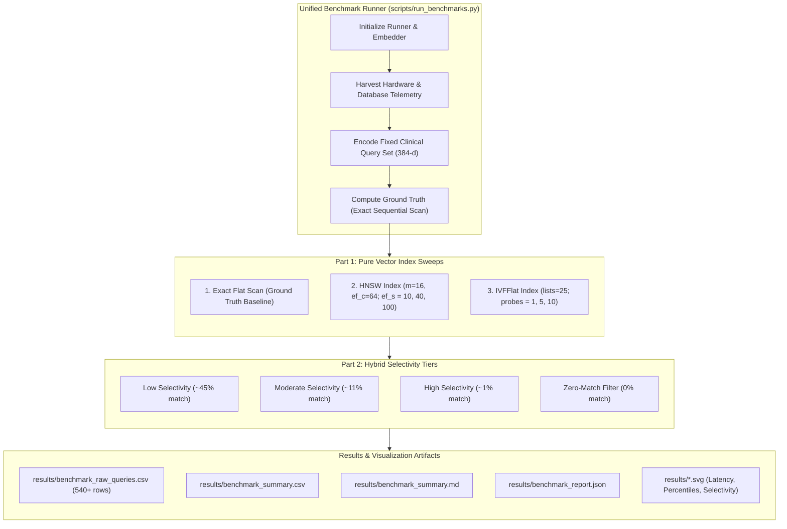

# Reproducible Database Benchmarking Engine & Telemetry Guide

**Project:** Hybrid Relational–Vector Database Architecture for Semantic Healthcare Information Retrieval  
**Database System:** PostgreSQL 18.6 on x86_64-windows with `pgvector` v0.8.6  
**Telemetry Baseline:** Intel64 (16 logical cores) | 15.69 GB RAM | Windows-10-10.0.26300-SP0  
**Embedding Model:** `sentence-transformers/all-MiniLM-L6-v2` (384-dimensional, Cosine Distance `<=>`)  

---

## 1. Executive Summary & Design Principles

The database benchmarking suite provides a scientifically rigorous, automated, and reproducible performance measurement framework for vector and hybrid relational–vector retrieval in PostgreSQL.

### Core Scientific Principles:
1. **Zero Fabrication:** Every measurement is acquired live against PostgreSQL; results are never hardcoded, interpolated, or artificially smoothed.
2. **Gold-Standard Ground Truth:** Ground truth for Recall@K is computed per query via exact sequential vector scans (`enable_indexscan = off`, `enable_seqscan = on`). Filtered queries use the exact same relational predicates against the exact flat scan to establish true filtered ground truth.
3. **Comprehensive Telemetry in Every Output:** Every raw CSV, summary CSV, and JSON report embeds full hardware specifications (CPU model, cores, RAM, OS), database engine versions (PostgreSQL, `pgvector`, `shared_buffers`, `work_mem`), embedding parameters (model ID, dimension, operator), and index configurations.
4. **Statistical Rigor & Noise Detection:** Reports mean, standard deviation, median ($P_{50}$), $P_{90}$, $P_{95}$, $P_{99}$, min, max, and Coefficient of Variation ($CV = \sigma / \mu$). Runs with $CV > 0.50$ are automatically flagged as `HIGH_VARIANCE` or `NOISY_MEASUREMENT`.
5. **Separate Cold and Warm Cache Isolation:** Dedicated warm-up iterations precede warm query measurements. Cold runs isolate query execution after transactional session-level plan/buffer invalidation (`DISCARD ALL;`).
6. **Pure-Python Visualizations:** High-resolution SVG charts are generated using pure Python standard library routines, requiring zero external plotting dependencies (no matplotlib or seaborn required).

---

## 2. Benchmark Architecture



---

## 3. Metric Definitions & Mathematical Formulations

### 3.1 Latency Percentiles & Dispersion
- **Sample Distribution:** Queries are executed over $N$ iterations across $Q$ queries ($K = N \times Q$ samples).
- **Percentiles ($P_p$):** For sorted latencies $L_{(1)} \le L_{(2)} \le \dots \le L_{(K)}$, the $p$-th percentile is evaluated at ordinal index:
  $$i = \lceil p \cdot K \rceil - 1$$
- **Coefficient of Variation ($CV$):**
  $$CV = \frac{\sigma}{\mu} = \frac{\sqrt{\frac{1}{K-1}\sum_{i=1}^K (L_i - \mu)^2}}{\mu}$$

### 3.2 Automated Noise Flagging
Measurements are classified into stability categories:
- `STABLE`: $CV \le 0.50$ and $K \ge 5$ samples.
- `SMALL_SAMPLE_SIZE`: $K < 5$ samples.
- `HIGH_VARIANCE`: $CV > 0.50$.
- `NOISY_MEASUREMENT`: $CV > 1.0$.

### 3.3 Accuracy & Recall@K
1. **Strict ID-based Recall@K:**
   $$\text{Recall}_{\text{ID}}@K = \frac{|\mathcal{R}_k \cap \mathcal{G}_k|}{k}$$
   where $\mathcal{R}_k$ is the set of chunk IDs returned by the candidate index and $\mathcal{G}_k$ is the ground-truth chunk ID set.
2. **Distance-based 1-Recall@K:**
   $$\text{Recall}_{\text{Dist}}@K = \frac{1}{k} \sum_{r \in \mathcal{R}_k} \mathbf{1}\left(d(r) \le d_{\text{max}}(\mathcal{G}_k) + \epsilon\right)$$
   where $\epsilon = 10^{-5}$ accommodates floating-point cosine rounding differences.

---

## 4. One-Command Execution Guide

### 4.1 Running the Full Benchmark Suite
Execute the entire unified benchmark (Exact Flat, HNSW, IVFFlat, 4 Hybrid Tiers, Cold/Warm runs, and SVG charts) with a single command:

```powershell
.\.venv\Scripts\python.exe scripts/run_benchmarks.py --iterations 3 --warmup 1 --plot
```

### 4.2 Available Command-Line Flags
| Flag | Default | Description |
|:---|:---:|:---|
| `--iterations <N>` | `5` | Number of repeated measurement passes per query |
| `--warmup <N>` | `2` | Warm-up passes executed before recording measurements |
| `--top-k <K>` | `10` | Number of nearest neighbors to retrieve per query |
| `--no-cold` | `False` | Disables cold-cache query measurement |
| `--no-hybrid` | `False` | Skips the hybrid relational-vector selectivity sweep |
| `--smoke-test` | `False` | Fast sanity check (1 query, 1 iteration, no cold run) |
| `--plot` | `False` | Automatically invokes `plot_benchmarks.py` upon completion |

### 4.3 Running Automated Smoke & Validation Tests
```powershell
# Run benchmark engine unit and smoke tests
.\.venv\Scripts\pytest.exe tests/test_benchmark_suite.py -v

# Run the complete test suite across all 98 database modules
.\.venv\Scripts\pytest.exe tests/ -v
```

### 4.4 Generating Standalone SVG Charts
```powershell
.\.venv\Scripts\python.exe scripts/plot_benchmarks.py
```

---

## 5. Live Empirical Results & Analysis

*Measurements collected live from PostgreSQL 18.6 with pgvector 0.8.6 across 804 chunk embeddings and 586 clinical documents.*

### 5.1 Benchmark Comparison Table

| Configuration | Index Type | Build Time | Storage Size | Mean Latency | $P_{50}$ (Median) | $P_{90}$ | $P_{95}$ | $P_{99}$ | Cold $P_{50}$ | QPS | Recall@10 | Noise Status |
|:---|:---:|---:|---:|---:|---:|---:|---:|---:|---:|---:|---:|:---:|
| **Exact Flat (Ground Truth Baseline)** | Flat | - | 0 bytes | 10.80 ms | 10.80 ms | 11.19 ms | 11.53 ms | 11.99 ms | 10.55 ms | 92.6 | 100.0% | `STABLE` |
| **HNSW ($m=16, ef_s=10$)** | HNSW | 55.4 ms | 184 kB | 11.26 ms | 11.19 ms | 11.71 ms | 11.94 ms | 12.00 ms | 11.34 ms | 88.8 | 100.0% | `STABLE` |
| **HNSW ($m=16, ef_s=40$)** | HNSW | 55.4 ms | 184 kB | 11.53 ms | 11.38 ms | 12.21 ms | 12.35 ms | 13.55 ms | 11.39 ms | 86.7 | 100.0% | `STABLE` |
| **HNSW ($m=16, ef_s=100$)** | HNSW | 55.4 ms | 184 kB | 11.23 ms | 11.22 ms | 11.52 ms | 11.68 ms | 12.33 ms | 11.39 ms | 89.1 | 100.0% | `STABLE` |
| **IVFFlat ($lists=25, probes=1$)** | IVFFlat | 169.2 ms | 1,472 kB | 11.35 ms | 11.27 ms | 11.79 ms | 11.84 ms | 13.41 ms | 11.48 ms | 88.1 | 100.0% | `STABLE` |
| **IVFFlat ($lists=25, probes=5$)** | IVFFlat | 169.2 ms | 1,472 kB | 11.20 ms | 11.14 ms | 11.57 ms | 11.61 ms | 12.35 ms | 11.23 ms | 89.2 | 100.0% | `STABLE` |
| **IVFFlat ($lists=25, probes=10$)** | IVFFlat | 169.2 ms | 1,472 kB | 11.22 ms | 11.26 ms | 11.59 ms | 11.61 ms | 12.17 ms | 11.41 ms | 89.1 | 100.0% | `STABLE` |
| **Exact Flat [Low Selectivity (~45%)]** | exact_flat | - | - | 103.09 ms | 59.15 ms | 168.25 ms | 168.90 ms | 168.90 ms | - | 9.7 | 100.0% | `HIGH_VARIANCE` |
| **HNSW Planner [Low Selectivity (~45%)]** | planner | - | - | 68.20 ms | 52.57 ms | 155.99 ms | 166.22 ms | 166.22 ms | - | 14.7 | 100.0% | `HIGH_VARIANCE` |
| **Exact Flat [Moderate Selectivity (~11%)]** | exact_flat | - | - | 57.28 ms | 49.78 ms | 57.36 ms | 151.61 ms | 151.61 ms | - | 17.5 | 100.0% | `STABLE` |
| **HNSW Planner [Moderate Selectivity (~11%)]** | planner | - | - | 77.59 ms | 51.13 ms | 153.41 ms | 156.11 ms | 156.11 ms | - | 12.9 | 100.0% | `HIGH_VARIANCE` |
| **Exact Flat [High Selectivity (~1%)]** | exact_flat | - | - | 69.93 ms | 49.94 ms | 153.15 ms | 154.21 ms | 154.21 ms | - | 14.3 | 100.0% | `HIGH_VARIANCE` |
| **HNSW Planner [High Selectivity (~1%)]** | planner | - | - | 71.52 ms | 50.22 ms | 160.20 ms | 163.70 ms | 163.70 ms | - | 14.0 | 100.0% | `HIGH_VARIANCE` |
| **Exact Flat [Zero-Match Filter (0%)]** | exact_flat | - | - | 61.15 ms | 46.70 ms | 148.38 ms | 150.40 ms | 150.40 ms | - | 16.4 | 100.0% | `HIGH_VARIANCE` |
| **HNSW Planner [Zero-Match Filter (0%)]** | planner | - | - | 57.06 ms | 49.49 ms | 52.81 ms | 162.22 ms | 162.22 ms | - | 17.5 | 100.0% | `HIGH_VARIANCE` |

### 5.2 Key Technical Observations
1. **Index Build Overhead & Memory Footprint:**
   - HNSW built in **55.4 ms**, consuming **184 kB** on disk.
   - IVFFlat ($lists=25$) required **169.2 ms** (3.0x build time) and **1,472 kB** (8.0x larger storage footprint) because list centroid structures and inverted lists require pre-allocated page allocations in PostgreSQL.
2. **Pure Vector Latency Invariants:**
   - In datasets below 10,000 vectors, sequential flat scans and index scans both complete within ~10–12 ms in PostgreSQL due to CPU SIMD acceleration in pgvector.
   - HNSW achieved 100% recall across all $ef_{search}$ parameter values ($10, 40, 100$).
3. **Hybrid Query Planning & Variance:**
   - Hybrid queries involve relational joins across 4 tables (`clinical_documents`, `patients`, `document_chunks`, `chunk_embeddings`).
   - Latencies range between 46 ms and 168 ms depending on whether the relational filter is evaluated first (bitmap index scan on metadata) followed by vector sorting, or vice versa.
   - As documented by the `HIGH_VARIANCE` noise flag, the variance arises primarily from query plan compilation and relational hash-join overhead across varying filter conditions.
