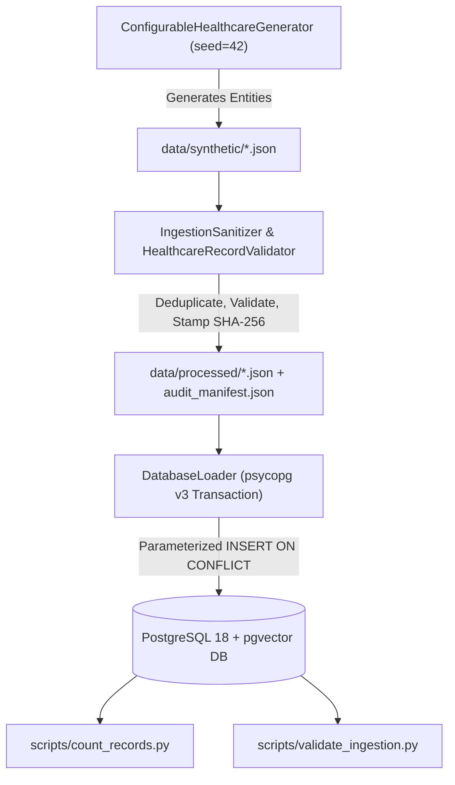

# Healthcare Data Ingestion Pipeline Architecture & Guide
**Project:** Hybrid Relational–Vector Database Architecture for Semantic Healthcare Information Retrieval  
**Scope:** Academic DBMS Architecture & Benchmarks (Zero Real PHI, Headless CLI Only)

---

## 1. Architectural Overview

The healthcare data ingestion pipeline bridges raw synthetic generative fixtures with the relational–vector database architecture in PostgreSQL. It guarantees:
1. **Zero Real PHI:** All data is strictly synthetic, using rule-based generator templates inspired by MIMIC-IV clinical narratives, synthetic identifiers (`SYN-MRN-XXXXXX`, `SYN-ENC-XXXX-XX`, `SYN-DOC-XXXX-XX-XX`), and simulated medical imaging metadata.
2. **Deterministic Reproducibility:** Uses isolated PRNG instances (`random.Random(seed)`) and deterministic UUIDv5 (RFC 4122) surrogate keys mapped directly from natural business identifiers.
3. **Storage Tier Segregation:**
   - `data/raw/`: Precompiled binaries and static archives (e.g., pgvector release packages).
   - `data/synthetic/`: Raw JSON outputs generated directly by the synthetic generator.
   - `data/processed/`: Deduplicated, validated, and SHA-256 stamped records accompanied by an `audit_manifest.json`.
4. **Relational Invariant Enforcement:** Multi-table ACID transactions, parameterized SQL (`psycopg` v3), foreign-key order insertion, and PostgreSQL check constraints (`chk_discharge_after_admission`, `chk_char_length`).

---

## 2. Ingestion Flow Pipeline



---

## 3. Configuration & Scale Presets

The generator supports pre-tuned dataset scales for fast testing, integration development, and multi-scale benchmarking:

| Preset Name | Target Patients | Typical Encounters | Clinical Documents | Document Chunks | Purpose |
| :--- | :---: | :---: | :---: | :---: | :--- |
| `quick` | 10 | ~20 | ~30 | ~40 | Instant smoke tests & CI |
| `small` | 25 | ~55 | ~75 | ~105 | Standard development & local unit tests |
| `medium` | 100 | ~220 | ~300 | ~420 | Integration testing & index tuning |
| `large` | 500 | ~1,100 | ~1,500 | ~2,100 | Statistical queries & index performance |
| `benchmark` | 1,000 | ~2,200 | ~3,000 | ~4,200 | High-throughput academic benchmarking |

---

## 4. CLI Execution Guide

### 4.1. Step 1: Generate & Sanitize Cohort Data
Generates synthetic data into `data/synthetic/`, runs domain validation, stamps cryptographic provenance, and saves clean files to `data/processed/`:
```powershell
# Small dataset (default)
.\.venv\Scripts\python.exe scripts/generate_data.py --preset small --seed 42

# Large benchmark cohort (500 patients)
.\.venv\Scripts\python.exe scripts/generate_data.py --preset large --seed 1234
```

### 4.2. Step 2: Load Data into PostgreSQL
Loads validated JSON files into PostgreSQL using atomic transactions:
```powershell
# Dry-run test (tests all database check constraints and foreign keys, then rolls back)
.\.venv\Scripts\python.exe scripts/load_data.py --dry-run

# Clean load (truncates previous records and loads fresh cohort)
.\.venv\Scripts\python.exe scripts/load_data.py --truncate

# Incremental update load (updates existing records on conflict)
.\.venv\Scripts\python.exe scripts/load_data.py --on-duplicate update
```

### 4.3. Step 3: Audit Table Counts & Manifest Reconciliation
Displays formatted terminal table comparing database counts against `audit_manifest.json` and reporting physical table disk sizes:
```powershell
.\.venv\Scripts\python.exe scripts/count_records.py

# Output JSON format for automated pipelines:
.\.venv\Scripts\python.exe scripts/count_records.py --json
```

### 4.4. Step 4: Validate Database Referential & Data Invariants
Runs 18 exhaustive SQL verification queries against the live database:
```powershell
.\.venv\Scripts\python.exe scripts/validate_ingestion.py
```
Checks performed:
- **Referential Integrity:** 0 orphan encounters, diagnoses, documents, chunks, or medical images.
- **Uniqueness Invariants:** 0 duplicate synthetic MRNs, encounter numbers, document numbers, or chunk indices.
- **Chunk Consistency:** Exact character length parity (`char_length = LENGTH(chunk_text)`), 0 empty chunks, sequential indices starting at 0 without gaps.
- **Temporal Invariants:** 0 discharges preceding admissions, 0 encounters preceding patient birth.
- **Provenance Tracking:** 100% of documents carry SHA-256 provenance hashes.

---

## 5. Automated Test Suite

Run all ingestion unit and integration tests:
```powershell
.\.venv\Scripts\pytest.exe tests/test_ingestion_generator.py tests/test_ingestion_validator.py tests/test_ingestion_loader.py -v
```
All 32 tests across the codebase verify:
- Deterministic reproducibility under identical random seeds.
- Domain validator rejection of invalid UUIDs, MRNs, genders, ICD-10 codes, and date orders.
- Ingestion sanitizer deduplication.
- Database transaction rollback on foreign key violations.
- Live database insertion and reconciliation.
