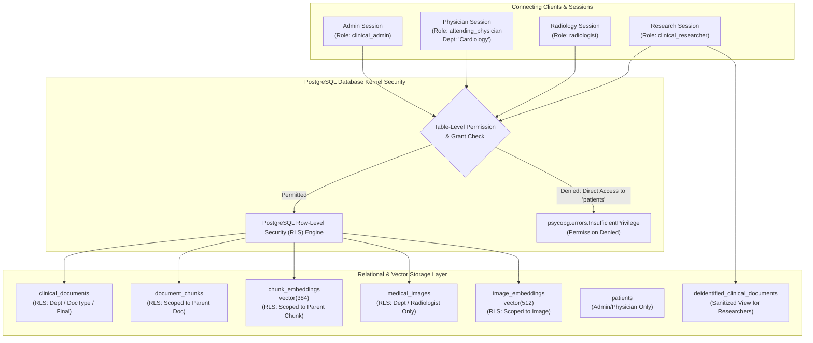

# Database-Level Security, Role-Based Access Control & Row-Level Security (RLS)

**Project:** Hybrid Relational–Vector Database Architecture for Semantic Healthcare Information Retrieval  
**Database System:** PostgreSQL 18.6 on x86_64-windows with `pgvector` v0.8.6  
**Security Model:** Least-Privilege Role-Based Access Control (RBAC) & Kernel-Level Row-Level Security (RLS)  
**Compliance Baseline:** HIPAA Minimum Necessary Standard (§164.502(b)) & De-Identification (§164.514)  

---

## 1. Architectural Overview & Security Objectives

In a healthcare relational-vector database, access control cannot be relegated to the application tier alone:
1. **Application-Layer Vulnerability:** If access control is implemented solely in web middleware or API application `WHERE` clauses, SQL injection, misconfigured endpoints, or direct analytical query tools can bypass application filters and exfiltrate sensitive Protected Health Information (PHI).
2. **Vector Similarity Leakage:** Even if direct text retrieval is restricted, high-dimensional vector embeddings can leak clinical state:
   - Calculating cosine distances against unauthorized clinical note embeddings can expose patient diagnoses or clinical events through nearest-neighbor ranking positions.
   - Chunks or document snippets returned alongside vector distances can reveal sensitive clinical narratives.
3. **Database-Level Defense-in-Depth:** Enforcing security at the **PostgreSQL kernel level** ensures that:
   - **Row-Level Security (RLS)** filters rows **before** vector distance calculation, index traversal, or sorting occurs.
   - Table-level grants strictly deny unauthorized operations (e.g. researchers cannot query the `patients` table directly).
   - Session settings (`SET LOCAL app.clinician_dept = '...'`) inject transactional context verified by database policies.



---

## 2. Least-Privilege PostgreSQL Role Hierarchy

The prototype implements four distinct functional roles and dedicated test login accounts:

| Role Name | Test Login User | Functional Scope | Relational Privileges | RLS Scope on Documents & Vectors |
|:---|:---|:---|:---|:---|
| **`clinical_admin`** | `user_admin` | Database Administrator | `ALL PRIVILEGES` on all tables & sequences | Unrestricted (`USING (true)`) across all relational and vector tables |
| **`attending_physician`** | `user_physician` | Inpatient / Outpatient Clinician | `SELECT` on patients, encounters, notes, chunks, embeddings, images | Scoped strictly to clinician's assigned department (`app.clinician_dept`) |
| **`radiologist`** | `user_radiologist` | Diagnostic Imaging Specialist | `SELECT` on imaging metadata, images, embeddings, radiology notes | Scoped strictly to `radiology_report` documents and all imaging assets |
| **`clinical_researcher`** | `user_researcher` | Epidemiological & AI Researcher | `SELECT` on de-identified views, chunks, embeddings; **NO** access to `patients` | Access restricted to `status = 'final'` de-identified views; direct access to `patients` and `medical_images` denied |

---

## 3. Row-Level Security (RLS) Invariants & Policy Definitions

Row-Level Security is explicitly enabled on all clinical narrative and vector embedding tables:
- `clinical_documents`
- `document_chunks`
- `chunk_embeddings`
- `medical_images`
- `image_embeddings`

### 3.1 Attending Physician Policies (Departmental Scoping)
Clinical sessions set their departmental assignment inside a transaction:
```sql
SET LOCAL app.clinician_dept = 'Cardiology';
```
The database policies enforce that a clinician in Cardiology can **only** read documents, chunks, and embeddings linked to Cardiology encounters:

```sql
CREATE POLICY physician_dept_embeddings ON chunk_embeddings
    FOR SELECT TO attending_physician
    USING (
        EXISTS (
            SELECT 1 FROM document_chunks dc
            JOIN clinical_documents cd ON dc.document_id = cd.document_id
            JOIN encounters e ON cd.encounter_id = e.encounter_id
            WHERE dc.chunk_id = chunk_embeddings.chunk_id
              AND (
                  e.department = NULLIF(current_setting('app.clinician_dept', true), '')
                  OR current_setting('app.clinician_dept', true) IS NULL
              )
        )
    );
```

### 3.2 Vector Search Leakage Prevention
A critical security guarantee demonstrated in this prototype:
> **Unauthorized rows are filtered out by the PostgreSQL query planner BEFORE cosine distance ranking, top-k heapsort, or text snippet projections are computed.**

When an attending physician in Cardiology executes a semantic vector query targeting an unauthorized specialty (e.g. querying for *"acute ischemic stroke middle cerebral artery infarct"*):
1. The table scan on `chunk_embeddings` evaluates `physician_dept_embeddings`.
2. All non-Cardiology chunks evaluate to `FALSE` and are omitted from the candidate set.
3. The cosine distance operator (`<=>`) is evaluated **only** on qualifying Cardiology rows.
4. Top-5 ranking results return 100% Cardiology documents; **zero** Neurology snippets, distances, or document IDs are exposed.

### 3.3 Radiologist Scope Enforcement
Radiologists are restricted to diagnostic imaging and radiology interpretations:
- `clinical_documents`: `document_type = 'radiology_report'`
- `document_chunks`: Parent document must be a `radiology_report`
- `chunk_embeddings`: Parent chunk must belong to a `radiology_report`
- `medical_images` & `image_embeddings`: Full `SELECT` access
- Any query attempting to read `discharge_summary` or `progress_note` returns `0` rows.

### 3.4 De-Identified Research Views & Direct Access Denial
In compliance with the HIPAA Safe Harbor de-identification principles (§164.514(b)):
1. **Direct `patients` Access Denied:**
   ```sql
   REVOKE ALL ON patients FROM clinical_researcher;
   ```
   Direct execution of `SELECT * FROM patients` or vector queries attempting to join `patients` to obtain `synthetic_mrn` fails immediately with `psycopg.errors.InsufficientPrivilege`.
2. **Sanitized Research Projections:**
   Researchers query `deidentified_clinical_documents`, `deidentified_document_chunks`, and `deidentified_chunk_embeddings`:
   - Direct identifiers (patient names, synthetic MRNs) are completely excluded.
   - `date_of_birth` is truncated to `birth_year`.
   - Patient age and gender are preserved for epidemiological analysis.

---

## 4. Live Verification & Test Matrix

The test suite [`tests/test_security_authorization.py`](file:///D:/HybridHealthcareVectorDB/tests/test_security_authorization.py) and CLI script [`scripts/verify_security.py`](file:///D:/HybridHealthcareVectorDB/scripts/verify_security.py) execute live database authorization checks using separate database accounts:

| Test Case | Role / User | Type | Demonstrated Security Control | Result |
|:---|:---|:---:|:---|:---:|
| **Admin Full Visibility** | `clinical_admin` | Positive | Full access to 586 docs, 804 chunks, 804 chunk vectors, 227 images, 227 image vectors | **PASS** |
| **Physician Department Scoping** | `attending_physician` (Cardiology) | Positive | Sees exactly 64 Cardiology documents and 85 chunks | **PASS** |
| **Cross-Department Isolation** | `attending_physician` (Cardiology) | Negative | Querying Neurology documents returns 0 rows | **PASS** |
| **Vector Search Leakage Prevention** | `attending_physician` (Cardiology) | Negative | Stroke semantic query returns 100% Cardiology rows; 0 Neurology snippets leaked | **PASS** |
| **Radiologist Imaging & Reports** | `radiologist` | Positive | Access to 109 radiology reports and 227 medical images | **PASS** |
| **Radiologist Non-Imaging Block** | `radiologist` | Negative | Querying discharge summaries and progress notes returns 0 rows | **PASS** |
| **Researcher De-Identified Views** | `clinical_researcher` | Positive | Access to 586 de-identified documents and 804 text vectors | **PASS** |
| **Researcher Direct Patients Block** | `clinical_researcher` | Negative | Direct `SELECT * FROM patients` rejected with `InsufficientPrivilege` | **PASS** |
| **Researcher Medical Images Block** | `clinical_researcher` | Negative | Direct `SELECT * FROM medical_images` rejected with `InsufficientPrivilege` | **PASS** |
| **Researcher Join Patients Block** | `clinical_researcher` | Negative | Vector search joining `patients.synthetic_mrn` rejected with `InsufficientPrivilege` | **PASS** |
| **Dedicated User Authentication** | `user_admin`, `user_physician`, etc. | Positive | Authenticated connection using environment credentials; `session_user` verified | **PASS** |

---

## 5. Security Verification Commands

```powershell
# 1. Audit PostgreSQL Catalog Roles, Table RLS Flags & Active Policies
.\.venv\Scripts\python.exe scripts/verify_security.py --audit-only

# 2. Run Full Positive & Negative Security Authorization Matrix
.\.venv\Scripts\python.exe scripts/verify_security.py

# 3. Execute Automated Security Test Suite
.\.venv\Scripts\pytest.exe tests/test_security_authorization.py -v

# 4. Run Full Regression Suite (All 90 Database, Ingestion, Retrieval, Multimodal & Security Tests)
.\.venv\Scripts\pytest.exe tests/ -v
```

---

## 6. Demonstrated Controls vs. Protections Not Implemented

To maintain academic rigor and transparent security boundaries, the following distinctions are explicitly documented:

### 6.1 Demonstrated Controls (Implemented & Verified in Prototype)
1. **PostgreSQL Native Role-Based Access Control (RBAC):**
   - Distinct functional roles (`clinical_admin`, `attending_physician`, `radiologist`, `clinical_researcher`) with least-privilege table grants.
   - Dedicated login test users (`user_admin`, `user_physician`, etc.) with environment-managed synthetic credentials.
2. **Kernel-Level Row-Level Security (RLS):**
   - Active policies on `clinical_documents`, `document_chunks`, `chunk_embeddings`, `medical_images`, and `image_embeddings`.
   - Dynamic departmental scoping via `SET LOCAL app.clinician_dept = '...'`.
3. **Vector Distance & Snippet Leakage Protection:**
   - Unauthorized rows are pruned prior to distance calculation and heapsort ranking, preventing ranking or metadata leakage.
4. **De-Identified Research Projections:**
   - Direct access to patient identification columns is revoked; researchers access sanitized views without MRNs or exact birthdates.
5. **Parameterized SQL Execution:**
   - All dynamic inputs are passed via psycopg tuple parameters (`%s`), preventing SQL injection.

### 6.2 Protections NOT Implemented (Future Work & Production Roadmap)
1. **Hardware Security Module (HSM) / KMS Envelope Encryption:**
   - Database tables are stored using default PostgreSQL storage; column-level encryption using external Key Management Services (e.g. AWS KMS, HashiCorp Vault) is not configured in this prototype.
2. **Differential Privacy (DP) for Vector Queries:**
   - In low-density vector spaces, repeated k-NN queries with carefully calibrated probe vectors could theoretically infer the presence of an outlier patient. Differential privacy noise injection is not currently implemented.
3. **Side-Channel Timing Defenses:**
   - Vector distance calculations are not constant-time; subtle latency differences between cache hits and cold scans are not normalized against timing attacks.
4. **Enterprise Identity Federation (SSO / Kerberos / OAuth2):**
   - User identities in this prototype use standard PostgreSQL username/password authentication rather than SAML 2.0, OpenID Connect, or Active Directory LDAP integrations.
5. **Comprehensive Audit Exfiltration Log Pipeline:**
   - PostgreSQL logs queries when configured, but an automated SIEM/Splunk streaming audit pipeline for real-time anomalous vector query detection is out of scope for this prototype.
