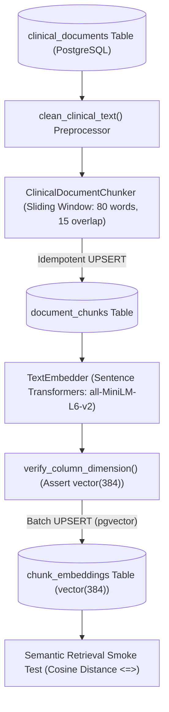

# Document Preprocessing, Chunking, Embedding & Vector Storage Guide
**Project:** Hybrid Relational–Vector Database Architecture for Semantic Healthcare Information Retrieval  
**Scope:** Academic DBMS Architecture & Experiments (Zero External APIs, Headless CLI Only)

---

## 1. Overview & Data Flow

This module implements the translation of unstructured clinical documents into dense vector representations stored natively in PostgreSQL using `pgvector`.



---

## 2. Architectural Components

### 2.1. Clinical Text Preprocessor & Chunker ([`src/embeddings/chunker.py`](file:///D:/HybridHealthcareVectorDB/src/embeddings/chunker.py))
- **Normalization:** Strips non-breaking spaces (`\xa0`), tabs, and redundant line breaks while retaining clinical section boundaries (e.g. `CHIEF COMPLAINT:`, `HOSPITAL COURSE:`).
- **Passage Segmentation:** Sliding-window passage chunker with configurable window length (default: 80 words ~ 104 tokens) and overlap (default: 15 words).
- **Metadata & ID Retention:**
  - Preserves source `document_id`.
  - Assigns contiguous 0-indexed sequence (`chunk_index = 0..N-1`).
  - Derives deterministic RFC 4122 **UUIDv5** `chunk_id` (`uuid.uuid5(uuid.NAMESPACE_DNS, f"{document_id}:{chunk_index}")`).
  - Calculates exact `char_length` and approximate `token_count`.
- **Database Upsert:**
  ```sql
  INSERT INTO document_chunks (
      chunk_id, document_id, chunk_index, chunk_text, token_count, char_length, created_at
  ) VALUES (%s, %s, %s, %s, %s, %s, CURRENT_TIMESTAMP)
  ON CONFLICT (document_id, chunk_index) DO UPDATE SET
      chunk_text = EXCLUDED.chunk_text,
      token_count = EXCLUDED.token_count,
      char_length = EXCLUDED.char_length,
      created_at = CURRENT_TIMESTAMP;
  ```

### 2.2. Text Embedder ([`src/embeddings/text_embedder.py`](file:///D:/HybridHealthcareVectorDB/src/embeddings/text_embedder.py))
- **Model:** `sentence-transformers/all-MiniLM-L6-v2` (384 dimensions, cosine distance metric).
- **Local Execution:** 100% self-contained locally. Zero clinical narratives or embeddings are transmitted over the internet or to external third-party APIs.
- **Normalization:** Every vector is explicitly L2-normalized ($\|v\|_2 = 1.0$) prior to database insertion.
- **Dimension Check:** Validates that `len(vector) == dimension` (384), raising `DimensionMismatchError` on divergence.
- **Deterministic Offline Fallback:** If PyTorch or HuggingFace weights are absent, activates a deterministic n-gram hashing feature extractor to guarantee offline unit testing and benchmarking continuity.

### 2.3. pgvector Storage & Model Registry ([`src/embeddings/vector_store.py`](file:///D:/HybridHealthcareVectorDB/src/embeddings/vector_store.py))
- **Registry Check:** Asserts that `model_id` exists in `embedding_models` with dimension 384 and metric `cosine`. Registers if absent.
- **Catalog Verification:** Queries PostgreSQL catalog (`pg_attribute.atttypmod`) to ensure the column `chunk_embeddings.embedding` is declared as `vector(384)`.
- **Batch Transactional Upsert:**
  ```sql
  INSERT INTO chunk_embeddings (
      embedding_id, chunk_id, model_id, dimension, embedding, created_at
  ) VALUES (%s, %s, %s, %s, %s, CURRENT_TIMESTAMP)
  ON CONFLICT (chunk_id, model_id) DO UPDATE SET
      dimension = EXCLUDED.dimension,
      embedding = EXCLUDED.embedding,
      created_at = CURRENT_TIMESTAMP;
  ```
  - `embedding_id` is deterministically generated via `uuid.uuid5(uuid.NAMESPACE_DNS, f"{chunk_id}:{model_id}")`.
  - Re-running the pipeline is **completely idempotent** (no duplicate vectors or orphaned chunks).

---

## 3. Hardware & Model Requirements

| Component | Minimum Specification | Recommended Specification |
| :--- | :--- | :--- |
| **CPU** | 4 cores (x86_64, AVX2 support) | 8+ cores (Intel Core i7/AMD Ryzen 7) |
| **RAM** | 8 GB RAM | 16 GB RAM |
| **GPU / VRAM** | None (CPU inference supported) | NVIDIA CUDA GPU with 4+ GB VRAM |
| **Disk Space** | ~200 MB for model weights cache | 1 GB for model cache + PyTorch |
| **HuggingFace Cache** | `~/.cache/huggingface/hub` | Configurable via `HF_HOME` env var |

### Model Architecture (`all-MiniLM-L6-v2`)
- **Base Architecture:** MiniLM (6 layers, 384 hidden dimension, 12 attention heads).
- **Parameters:** ~22.7 Million parameters.
- **Max Sequence Length:** 256 word pieces / tokens.
- **Pretrained Corpus:** 1 Billion+ sentence pairs (SNLI, MultiNLI, MS-MARCO).

---

## 4. Instructions for Downloading Model Weights

To download and cache the official Sentence Transformers model weights locally on Windows:

```powershell
# 1. Install PyTorch (CPU-only build to avoid 2.5GB CUDA overhead)
.\.venv\Scripts\pip.exe install torch torchvision --index-url https://download.pytorch.org/whl/cpu

# 2. Install sentence-transformers
.\.venv\Scripts\pip.exe install sentence-transformers

# 3. Pre-download and cache model weights locally (~90 MB)
.\.venv\Scripts\python.exe -c "from sentence_transformers import SentenceTransformer; model = SentenceTransformer('sentence-transformers/all-MiniLM-L6-v2'); print('Model weights cached successfully:', model)"
```

---

## 5. CLI Execution & Verification

### 5.1. Generate Chunks & Store Vectors in PostgreSQL
```powershell
# Vectorize all un-embedded document chunks
.\.venv\Scripts\python.exe scripts/embed_documents.py

# Force re-chunking of documents and vector refresh
.\.venv\Scripts\python.exe scripts/embed_documents.py --rechunk --force

# Run semantic retrieval smoke test after embedding
.\.venv\Scripts\python.exe scripts/embed_documents.py --smoke-test
```

### 5.2. Audit Embedding Counts & Invariants
```powershell
# Check embedding counts and coverage
.\.venv\Scripts\python.exe scripts/embed_documents.py --verify-only

# Comprehensive table sizes & manifest reconciliation
.\.venv\Scripts\python.exe scripts/count_records.py
```

### 5.3. Automated Test Suite
Run all 40 automated unit, integration, and database tests:
```powershell
.\.venv\Scripts\pytest.exe -v
```

---

## 6. Untested Assumptions & Limitations

1. **Token Count Approximation:** `token_count` is calculated using heuristic word-to-token ratio ($1.3 \times \text{words}$) when running without a tokenizer instance. For exact WordPiece counts, load the HuggingFace `AutoTokenizer`.
2. **Fixed Vector Column Dimensions:** PostgreSQL `chunk_embeddings` column `embedding` is hardcoded to `vector(384)`. Storing higher-dimensional embeddings (e.g. 768-d PubMedBERT) requires either an additional table or altering the column definition.
3. **Chunk Boundary Alignment:** Sliding-window word chunking may split clinical sentences mid-clause. A sentence-aware chunker (e.g., using spacy or regex sentence boundaries) can be evaluated in subsequent benchmark phases.
4. **Medical Image Embeddings:** Medical image vector storage (`image_embeddings`, 512-d) is defined in schema and simulated; live execution of vision encoders (CLIP/BiomedCLIP) requires local image files.
