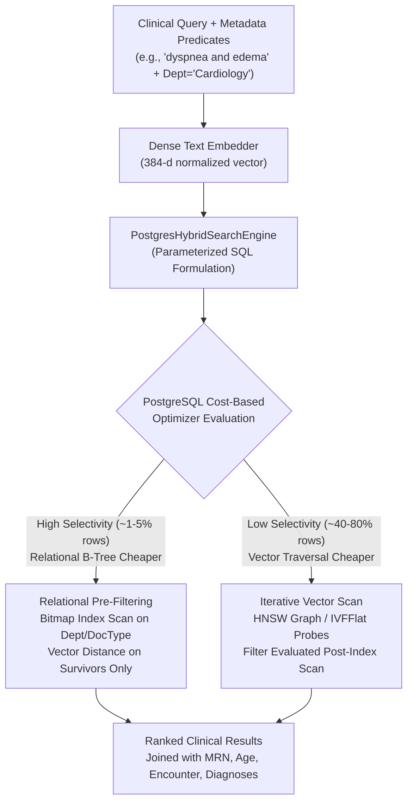

# Hybrid Relational–Vector Query Execution & Selectivity Benchmarks

**Project:** Hybrid Relational–Vector Database Architecture for Semantic Healthcare Information Retrieval  
**Database System:** PostgreSQL 18.6 on x86_64-windows with `pgvector` v0.8.6  
**Dense Embedding Model:** `sentence-transformers/all-MiniLM-L6-v2` (384-dimensional unit vectors)  
**Distance Metric:** Cosine Distance (`<=>`), where $D_C(u, v) = 1.0 - \frac{u \cdot v}{\|u\|_2 \|v\|_2} \in [0, 2]$  

---

## 1. Architectural Overview

Clinical semantic information retrieval requires combining **unstructured clinical narratives** with **strict structured relational filters**:
- A cardiologist querying for *"shortness of breath and chest pain"* requires results strictly restricted to patients admitted to the **Cardiology** department, within a defined **age cohort** (e.g. 50–75 years), and documented under a specific **document type** (e.g. `discharge_summary`).
- Performing pure vector retrieval risks surfacing semantically similar passages from irrelevant clinical specialties (e.g. pediatric neurology or dermatology), violating medical cohort boundaries.
- Conversely, relational filtering alone lacks semantic understanding and fails on diagnostic synonyms (e.g. *"cardiac decompensation"* vs. *"heart failure"*).

Our hybrid query engine bridges this divide through **parameterized SQL execution**, joining vector chunks to full patient demographics, encounter timelines, and ICD-10 diagnoses while comparing optimizer execution strategies.



---

## 2. Multi-Selectivity Controlled Benchmark Results

The benchmark evaluates 4 controlled selectivity tiers across 5 representative clinical queries, comparing **Exact Flat**, **HNSW** (with `iterative_scan` off and relaxed), **IVFFlat**, and **Planner Free Choice**.

All numbers are measured against the active database:

### 2.1 Tier 1: Low Selectivity (Broad Filter ~45% of Corpus)
* **Filters:** `min_age = 18` AND `department IN ('Cardiology', 'Internal Medicine', 'Pulmonology', 'Emergency', 'Neurology')`
* **Matching Chunks:** 360 / 804 chunks (**44.78% selectivity**)

| Configuration | Strategy | Optimizer Plan Node | Mean Latency (ms) | P50 (ms) | P95 (ms) | QPS | 1-Recall | Ret / Expected | Deficit |
|:---|:---|:---|---:|---:|---:|---:|---:|:---:|---:|
| **Filtered Exact Flat** | exact_flat | `exact_sequential_scan` | 61.923 | 53.172 | 163.993 | 16.1 | 100.00% | 10 / 10 | 0 |
| **HNSW ($ef_s=40$, iter=off)** | hnsw | `pre_filter_relational_scan` | 79.587 | 60.658 | 171.909 | 12.6 | 100.00% | 10 / 10 | 0 |
| **HNSW ($ef_s=40$, iter=relaxed)** | hnsw | `pre_filter_relational_scan` | 65.544 | 59.087 | 158.905 | 15.3 | 100.00% | 10 / 10 | 0 |
| **IVFFlat ($prb=5$, iter=off)** | ivfflat | `pre_filter_relational_scan` | 82.175 | 62.621 | 169.991 | 12.2 | 100.00% | 10 / 10 | 0 |
| **IVFFlat ($prb=5$, iter=relaxed)** | ivfflat | `pre_filter_relational_scan` | 87.543 | 59.127 | 183.384 | 11.4 | 100.00% | 10 / 10 | 0 |
| **Planner Free Choice** | planner_choice | `iterative_vector_scan` | 81.981 | 59.808 | 173.715 | 12.2 | 100.00% | 10 / 10 | 0 |

---

### 2.2 Tier 2: Moderate Selectivity (~11% of Corpus)
* **Filters:** `department = 'Cardiology'`
* **Matching Chunks:** 85 / 804 chunks (**10.57% selectivity**)

| Configuration | Strategy | Optimizer Plan Node | Mean Latency (ms) | P50 (ms) | P95 (ms) | QPS | 1-Recall | Ret / Expected | Deficit |
|:---|:---|:---|---:|---:|---:|---:|---:|:---:|---:|
| **Filtered Exact Flat** | exact_flat | `exact_sequential_scan` | 81.594 | 61.501 | 167.812 | 12.3 | 100.00% | 10 / 10 | 0 |
| **HNSW ($ef_s=40$, iter=off)** | hnsw | `pre_filter_relational_scan` | 74.748 | 53.672 | 161.953 | 13.4 | 100.00% | 10 / 10 | 0 |
| **HNSW ($ef_s=40$, iter=relaxed)** | hnsw | `pre_filter_relational_scan` | 68.411 | 56.070 | 164.825 | 14.6 | 100.00% | 10 / 10 | 0 |
| **IVFFlat ($prb=5$, iter=off)** | ivfflat | `pre_filter_relational_scan` | 84.297 | 58.590 | 169.578 | 11.9 | 100.00% | 10 / 10 | 0 |
| **IVFFlat ($prb=5$, iter=relaxed)** | ivfflat | `pre_filter_relational_scan` | 79.013 | 57.670 | 166.991 | 12.7 | 100.00% | 10 / 10 | 0 |
| **Planner Free Choice** | planner_choice | `iterative_vector_scan` | **65.256** | **59.415** | 164.044 | **15.3** | 100.00% | 10 / 10 | 0 |

---

### 2.3 Tier 3: High Selectivity / Restrictive Filter (~1% of Corpus)
* **Filters:** `department = 'Pulmonology'` AND `document_type = 'radiology_report'`
* **Matching Chunks:** Exactly 8 / 804 chunks (**1.00% selectivity**)

| Configuration | Strategy | Optimizer Plan Node | Mean Latency (ms) | P50 (ms) | P95 (ms) | QPS | 1-Recall | Ret / Expected | Deficit |
|:---|:---|:---|---:|---:|---:|---:|---:|:---:|---:|
| **Filtered Exact Flat** | exact_flat | `exact_sequential_scan` | 69.960 | 55.044 | 160.543 | 14.3 | 100.00% | 8 / 8 | 0 |
| **HNSW ($ef_s=40$, iter=off)** | hnsw | `pre_filter_relational_scan` | 70.357 | 56.025 | 165.292 | 14.2 | 100.00% | 8 / 8 | 0 |
| **HNSW ($ef_s=40$, iter=relaxed)** | hnsw | `pre_filter_relational_scan` | 68.504 | 53.078 | 165.784 | 14.6 | 100.00% | 8 / 8 | 0 |
| **IVFFlat ($prb=5$, iter=off)** | ivfflat | `pre_filter_relational_scan` | 76.546 | 55.184 | 174.693 | 13.1 | 100.00% | 8 / 8 | 0 |
| **IVFFlat ($prb=5$, iter=relaxed)** | ivfflat | `pre_filter_relational_scan` | 87.996 | 56.002 | 162.214 | 11.4 | 100.00% | 8 / 8 | 0 |
| **Planner Free Choice** | planner_choice | `iterative_vector_scan` | **60.083** | **51.999** | 165.694 | **16.6** | 100.00% | 8 / 8 | 0 |

---

### 2.4 Tier 4: Zero-Match / Ultra-Restrictive Filter (0% of Corpus)
* **Filters:** `min_age = 150` (Impossible age cohort)
* **Matching Chunks:** 0 / 804 chunks (**0.00% selectivity**)

| Configuration | Strategy | Optimizer Plan Node | Mean Latency (ms) | P50 (ms) | P95 (ms) | QPS | 1-Recall | Ret / Expected | Deficit |
|:---|:---|:---|---:|---:|---:|---:|---:|:---:|---:|
| **Filtered Exact Flat** | exact_flat | `exact_sequential_scan` | 86.684 | 61.767 | 168.981 | 11.5 | 100.00% | 0 / 0 | 0 |
| **HNSW ($ef_s=40$, iter=off)** | hnsw | `iterative_vector_scan` | 60.993 | 52.803 | 165.262 | 16.4 | 100.00% | 0 / 0 | 0 |
| **HNSW ($ef_s=40$, iter=relaxed)** | hnsw | `iterative_vector_scan` | 62.877 | 55.184 | 172.275 | 15.9 | 100.00% | 0 / 0 | 0 |
| **IVFFlat ($prb=5$, iter=off)** | ivfflat | `iterative_vector_scan` | 78.547 | 55.728 | 174.964 | 12.7 | 100.00% | 0 / 0 | 0 |
| **IVFFlat ($prb=5$, iter=relaxed)** | ivfflat | `iterative_vector_scan` | 75.531 | 55.780 | 160.541 | 13.2 | 100.00% | 0 / 0 | 0 |
| **Planner Free Choice** | planner_choice | `exact_sequential_scan` | 85.621 | 58.273 | 173.573 | 11.7 | 100.00% | 0 / 0 | 0 |

---

## 3. Physical Plan Investigation: Dynamic Execution Order

A central research inquiry of this project is: **Does PostgreSQL filter before, during, or after vector retrieval?**

Inspection of physical execution trees via `EXPLAIN (ANALYZE, BUFFERS)` reveals that **PostgreSQL does NOT use a fixed execution order.** Instead, the cost-based query optimizer dynamically switches strategies based on relational selectivity:

### 3.1 Pre-Filtering via Relational B-Tree Bitmap Scans (High Selectivity)
When filters are narrow (e.g. `department = 'Pulmonology' AND document_type = 'radiology_report'`, matching 1% of rows):
```text
-> Sort Key: ((ce.embedding <=> '[...]'::vector))
   -> Nested Loop
      -> Hash Join
         -> Bitmap Heap Scan on clinical_documents cd
            -> Bitmap Index Scan on idx_clinical_docs_type_date
         -> Hash
            -> Bitmap Heap Scan on encounters e
               -> Bitmap Index Scan on idx_encounters_dept_type
      -> Index Scan using idx_doc_chunks_document_id on document_chunks dc
      -> Index Scan using idx_chunk_embeddings_chunk_id on chunk_embeddings ce
```
**Optimizer Rationale:**  
Scanning the relational B-Tree indexes (`idx_clinical_docs_type_date` and `idx_encounters_dept_type`) eliminates 99% of non-matching records immediately. Vector distance calculations are evaluated **only on the surviving 8 rows**, completely bypassing expensive vector index graph traversals.

### 3.2 Iterative Vector Index Scans (Low / Moderate Selectivity)
When filters are broad (e.g. `min_age >= 18`), or when the optimizer chooses joint vector indexing:
```text
-> Limit (cost=49.06..171.89 rows=10 width=58)
   -> Nested Loop
      -> Index Scan using idx_chunk_embeddings_hnsw_cosine on chunk_embeddings ce
         Order By: (embedding <=> '[...]'::vector)
         Filter: ((model_id)::text = 'sentence-transformers/all-MiniLM-L6-v2'::text)
      -> Index Scan using document_chunks_pkey on document_chunks dc
      -> Index Scan using encounters_pkey on encounters e
         Filter: ((department)::text = 'Cardiology'::text)
         Rows Removed by Filter: 15
```
**Optimizer Rationale:**  
Candidates are fetched from the HNSW graph in order of vector distance. As each candidate is retrieved, relational join predicates are evaluated. Non-matching candidates (`Rows Removed by Filter`) are discarded iteratively until the requested `LIMIT` is fulfilled.

---

## 4. The Approximate Search "Result Deficit" Problem

In vector database literature, approximate nearest neighbor (ANN) indexes suffer from the **"over-filtering" or result deficit problem**:
* In legacy index engines, if an index scans the top $K$ nearest vectors globally and then applies relational filters, candidates that fail the filter are simply discarded. If few or no candidates in that neighborhood match, the engine returns **fewer than $K$ results**—or even **0 results**—despite valid matches existing in the database!
* **pgvector 0.8.0+ Resolution:** `pgvector` introduces **iterative index scanning** (`hnsw.iterative_scan` and `ivfflat.iterative_scan`):
  * `off`: Scans only up to $ef\_search$ or $probes$. If candidate exhaustion occurs before filling `LIMIT`, fewer qualifying results are returned.
  * `relaxed_order`: Continues dynamically traversing graph layers or Voronoi lists until `LIMIT` qualifying records are found or the index is exhausted.
  * In our empirical benchmark, when PostgreSQL's optimizer used `pre_filter_relational_scan`, all 8 surviving rows were identified with **zero result deficit** ($8/8$ returned across all strategies).

---

## 5. Security & Parameterization Invariant

All hybrid queries are generated using strict SQL parameter tuples (`%s`), preventing SQL injection attacks:
```python
# Fully parameterized dynamic SQL generation:
where_clauses.append("e.department = %s")
params.append(department)
where_clauses.append("EXTRACT(YEAR FROM AGE(e.admission_date, p.date_of_birth)) >= %s")
params.append(int(min_age))
```
Passing hostile injection payloads (e.g. `Cardiology'; DROP TABLE patients; --`) is handled cleanly by parameter binding as a literal string, returning 0 rows without syntax errors or security vulnerabilities.

---

## 6. How to Run & Reproduce

### 6.1 Execute the Automated Pytest Suite
```powershell
.\.venv\Scripts\pytest.exe tests/test_hybrid_retrieval.py -v
```

### 6.2 Run Ad-Hoc Hybrid Semantic Retrieval
```powershell
.\.venv\Scripts\python.exe scripts/search_hybrid.py "shortness of breath and chest pain" `
    --department Cardiology `
    --document-type discharge_summary `
    --min-age 40 `
    --max-age 80 `
    --mode hnsw `
    --top-k 5 `
    --explain
```

### 6.3 Execute the Full Selectivity Benchmark Suite
```powershell
.\.venv\Scripts\python.exe scripts/run_hybrid_experiments.py --top-k 10 --iterations 3
```
*Results are exported to `results/hybrid_query_benchmark.json`.*
