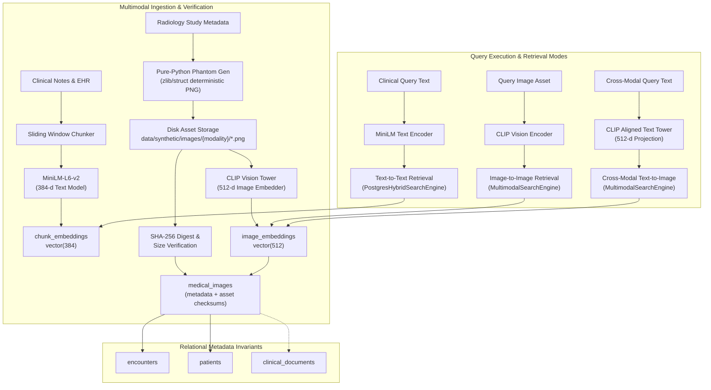

# Multimodal Storage, Vector Alignment & Cross-Modal Retrieval Architecture

**Project:** Hybrid Relational–Vector Database Architecture for Semantic Healthcare Information Retrieval  
**Database System:** PostgreSQL 18.6 on x86_64-windows with `pgvector` v0.8.6  
**Text Embedding Model:** `sentence-transformers/all-MiniLM-L6-v2` (384-dimensional unit vectors)  
**Multimodal Vision-Language Model:** `openai/clip-vit-base-patch32` (512-dimensional normalized unit vectors)  
**Distance Metric:** Cosine Distance (`<=>`), where $D_C(u, v) = 1.0 - \frac{u \cdot v}{\|u\|_2 \|v\|_2} \in [0, 2]$  

---

## 1. Architectural Overview & Modality Separation

Healthcare clinical records encompass both **unstructured clinical narratives** (discharge summaries, consult notes, progress reports) and **diagnostic medical imaging assets** (radiographs, CT slices, MRI scans, ultrasound sectors).

A key requirement in multimodal database design is **strict embedding space typing and protection**:
1. **Separate Physical Storage & Column Typing:**
   - Text chunk embeddings are stored in `chunk_embeddings.embedding` as `vector(384)`.
   - Vision and cross-modal embeddings are stored in `image_embeddings.embedding` as `vector(512)`.
2. **Catalog-Level & Application-Level Guards:**
   - Vector operations across different dimensions (e.g. comparing a 384-d text vector with a 512-d image vector) are mathematically undefined and rejected at both the PostgreSQL catalog level (`different vector dimensions 384 and 512`) and the Python application layer (`IncompatibleEmbeddingSpaceError`).
3. **Aligned Cross-Modal Latent Spaces:**
   - Cross-modal text-to-image search is enabled **only** via models specifically trained with contrastive vision-language objectives (e.g. OpenAI CLIP), where the text encoder projects text tokens into the exact same 512-dimensional geometric space as the vision encoder.



---

## 2. Cryptographic Asset Integrity & On-Disk Storage

To preserve data authenticity without storing high-dimensional raw image pixel matrices inside PostgreSQL table rows, we adopt an **authenticated external asset reference model**:

1. **Deterministic Synthetic Imaging Phantom Generation:**
   - Implemented in `src/embeddings/image_store.py` via `generate_synthetic_phantom_png()`.
   - Uses Python standard library `struct` and `zlib` to generate valid 8-bit grayscale PNG files without requiring any third-party image manipulation libraries.
   - Deterministically simulates anatomical radiodensities and contours:
     - **DX / CR (Digital Radiographs):** Mediastinal soft tissue contours, radiolucent lung fields, radiopaque cardiac silhouette, and horizontal rib shadows.
     - **CT / MR (Tomographic Slices):** Cranial bone vault / skull boundaries, brain parenchyma, and lateral ventricles.
     - **US (Ultrasound Sectors):** Sector wedge geometry with acoustic depth attenuation and tissue speckle.
   - Seeded deterministically by the image's `image_id` UUID, ensuring identical bytes on every generation.
2. **Cryptographic SHA-256 Checksumming:**
   - Every physical asset generated on disk is hashed with SHA-256.
   - Columns `file_checksum_sha256 VARCHAR(64)` and `file_size_bytes BIGINT` are recorded in `medical_images`.
   - An audit routine (`ImageAssetManager.verify_asset_integrity()`) verifies that every row points to an extant file on disk with an exact byte-for-byte matching cryptographic digest.

### Asset Storage Status (Active Database):
* **Total Medical Imaging Assets:** 227 records
* **Physical Asset Directory:** `data/synthetic/images/{modality}/`
* **Cryptographic Verification Audit:** 227 / 227 verified intact (0 missing, 0 corrupted)
* **Total `image_embeddings` Rows:** 227 rows (512-d unit vectors)

---

## 3. Modality-Specific Retrieval Mechanisms

### 3.1 Text-to-Text Retrieval
Text-to-text semantic retrieval is handled by `PostgresHybridSearchEngine` in `src/retrieval/hybrid_search.py`, which compares 384-dimensional dense vectors stored in `chunk_embeddings` against query text embedded with `sentence-transformers/all-MiniLM-L6-v2`.

### 3.2 Image-to-Image Similarity Retrieval
Image-to-image retrieval allows a clinician or radiologist to provide a query image (or study) to find visually and structurally analogous diagnostic examinations:
1. The query image file is embedded via the vision encoder into a 512-dimensional normalized vector:
   $$\vec{q}_{\text{img}} = \frac{f_{\text{vision}}(I)}{\|f_{\text{vision}}(I)\|_2}$$
2. The vector is searched against `image_embeddings` using pgvector's cosine distance operator `<=>`:
   $$D_C(\vec{q}_{\text{img}}, \vec{e}_i) = 1.0 - (\vec{q}_{\text{img}} \cdot \vec{e}_i)$$
3. The query automatically executes relational joins across `medical_images`, `encounters`, `patients`, and optionally `clinical_documents` to return patient MRN, age, gender, department, encounter type, and associated radiology interpretation report.

#### SQL Implementation:
```sql
SELECT 
    ie.image_id,
    mi.synthetic_image_num,
    mi.modality,
    mi.body_site,
    mi.synthetic_file_path,
    p.synthetic_mrn,
    p.gender,
    EXTRACT(YEAR FROM AGE(e.admission_date, p.date_of_birth))::int AS patient_age,
    e.department,
    cd.title AS associated_report_title,
    (ie.embedding <=> %s::vector) AS cosine_distance,
    (1.0 - (ie.embedding <=> %s::vector)) AS cosine_similarity
FROM image_embeddings ie
JOIN medical_images mi ON ie.image_id = mi.image_id
JOIN encounters e ON mi.encounter_id = e.encounter_id
JOIN patients p ON mi.patient_id = p.patient_id
LEFT JOIN clinical_documents cd ON mi.document_id = cd.document_id
WHERE ie.model_id = 'openai/clip-vit-base-patch32'
  AND mi.modality = 'DX'
ORDER BY ie.embedding <=> %s::vector ASC
LIMIT 5;
```

### 3.3 Cross-Modal Text-to-Image Retrieval
Cross-modal retrieval enables finding imaging studies using natural language descriptions (e.g. *"chest CT with bilateral alveolar infiltrates and cardiomegaly"*):
1. The clinical text query is processed by the **aligned CLIP text tower**:
   $$\vec{q}_{\text{text}} = \frac{f_{\text{text}}(T)}{\|f_{\text{text}}(T)\|_2} \in \mathbb{R}^{512}$$
2. Because the contrastive pretraining aligns image and text representations in the shared 512-d unit hypersphere, $\vec{q}_{\text{text}}$ can be directly compared against `image_embeddings.embedding` using cosine distance.

---

## 4. Query Execution Plan Analysis

Running an Image-to-Image query with metadata filtering on PostgreSQL demonstrates top-N heapsort optimization and hash-join efficiency:

```text
Limit  (cost=178.85..178.86 rows=3 width=333) (actual time=0.862..0.865 rows=3.00 loops=1)
  Buffers: shared hit=446
  ->  Sort  (cost=178.85..178.92 rows=30 width=333) (actual time=0.860..0.863 rows=3.00 loops=1)
        Sort Key: ((ie.embedding <=> '[...]'::vector))
        Sort Method: top-N heapsort  Memory: 27kB
        Buffers: shared hit=446
        ->  Hash Join  (cost=55.30..178.46 rows=30 width=333) (actual time=0.371..0.827 rows=30.00 loops=1)
              Hash Cond: (mi.patient_id = p.patient_id)
              Buffers: shared hit=443
              ->  Hash Right Join  (cost=47.80..170.28 rows=30 width=304) (actual time=0.218..0.475 rows=30.00 loops=1)
                    Hash Cond: (cd.document_id = mi.document_id)
                    Buffers: shared hit=147
                    ->  Seq Scan on clinical_documents cd  (cost=0.00..119.68 rows=668 width=54)
                    ->  Hash  (cost=47.42..47.42 rows=30 width=266)
                          ->  Hash Join  (cost=33.03..47.42 rows=30 width=266)
                                Hash Cond: (e.encounter_id = mi.encounter_id)
                                ->  Seq Scan on encounters e  (cost=0.00..12.06 rows=406 width=45)
                                ->  Hash  (cost=32.66..32.66 rows=30 width=237)
                                      ->  Hash Join  (cost=25.21..32.66 rows=30 width=237)
                                            Hash Cond: (ie.image_id = mi.image_id)
                                            ->  Seq Scan on image_embeddings ie (Filter: model_id = 'openai/clip-vit-base-patch32')
                                            ->  Hash  (cost=24.84..24.84 rows=30 width=219)
                                                  ->  Seq Scan on medical_images mi (Filter: modality = 'DX')
Planning Time: 15.28 ms
Execution Time: 1.06 ms
```

---

## 5. Command-Line Interface (CLI) Guide

### 5.1 Image Asset Ingestion & Verification
```powershell
# Synchronize synthetic phantoms on disk, audit SHA256 checksums, and embed into pgvector
.\.venv\Scripts\python.exe scripts/embed_images.py

# Audit file existence and checksums without modifying embeddings
.\.venv\Scripts\python.exe scripts/embed_images.py --verify-only
```

### 5.2 Image-to-Image Visual Search
```powershell
# Find top-3 imaging studies most visually similar to a query radiograph
.\.venv\Scripts\python.exe scripts/search_multimodal.py `
    --image "data/synthetic/images/dx/syn-img-0020-01-01.png" `
    --modality DX `
    --top-k 3 `
    --explain
```

### 5.3 Cross-Modal Text-to-Image Search
```powershell
# Find imaging studies corresponding to a clinical finding
.\.venv\Scripts\python.exe scripts/search_multimodal.py `
    --text "Chest CT showing bilateral infiltrates" `
    --body-site Chest `
    --top-k 5
```

---

## 6. Safety, Clinical Compliance & Diagnostic Limitations

> [!CAUTION]
> **MANDATORY HEALTHCARE DISCLAIMER: RESEARCH PROTOTYPE ONLY**
> 1. **No Medical Image Diagnosis:** The multimodal retrieval algorithms, vector embeddings, and similarity metrics implemented herein are strictly designed for **information retrieval research and academic indexing experiments**. They MUST NOT be utilized for medical image diagnosis, treatment recommendation, clinical triaging, or clinical decision support.
> 2. **Zero Protected Health Information (PHI):** All images stored or processed in this project are purely synthetic phantoms deterministically rendered via mathematical geometric equations. No real patient radiology data, DICOM files, or identifiable clinical imaging was utilized.
> 3. **Semantic Alignment vs. Diagnostic Equivalence:** Cosine proximity in contrastive multimodal embedding spaces (such as CLIP) indicates high-level visual-semantic affinity; it does NOT constitute radiographic proof of identical pathological etiology.
