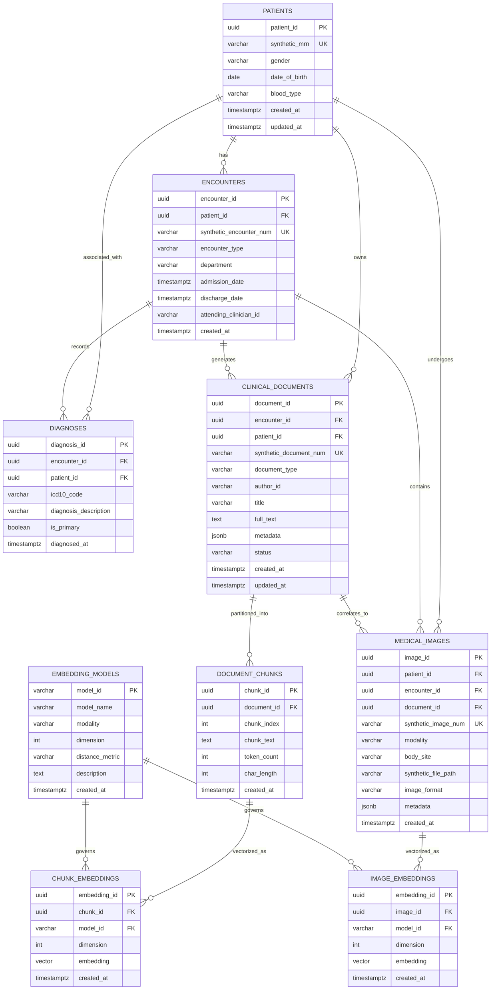

# Database Schema Architecture & Data Dictionary
**Project:** Hybrid Relational–Vector Database Architecture for Semantic Healthcare Information Retrieval  
**Engine:** PostgreSQL 16+ with `pgvector` Extension  
**Focus:** Database internals, hybrid relational-plus-vector querying, multimodal embeddings, and strict storage decoupling

---

## 1. Entity-Relationship (ER) Diagram



---

## 2. Relational Schema Data Dictionary

### 2.1 Table: `patients`
Represents synthetic patient demographic profiles. Synthetic identifiers ensure zero Personal Health Information (PHI) exposure.

| Column | Type | Constraints | Description |
|---|---|---|---|
| `patient_id` | `UUID` | `PRIMARY KEY`, Default `gen_random_uuid()` | Internal surrogate key |
| `synthetic_mrn` | `VARCHAR(32)` | `UNIQUE`, `NOT NULL` | Synthetic Medical Record Number (e.g. `SYN-MRN-928174`) |
| `gender` | `VARCHAR(16)` | `NOT NULL`, `CHECK (gender IN ('M', 'F', 'OTHER', 'UNKNOWN'))` | Patient administrative biological sex |
| `date_of_birth` | `DATE` | `NOT NULL` | Date of birth for age-stratified clinical cohorts |
| `blood_type` | `VARCHAR(8)` | `NULL`, `CHECK (blood_type IN ('A+', 'A-', 'B+', 'B-', 'AB+', 'AB-', 'O+', 'O-'))` | Clinical blood group |
| `created_at` | `TIMESTAMPTZ` | `NOT NULL`, Default `CURRENT_TIMESTAMP` | Row creation audit timestamp |
| `updated_at` | `TIMESTAMPTZ` | `NOT NULL`, Default `CURRENT_TIMESTAMP` | Row modification audit timestamp |

### 2.2 Table: `encounters`
Models inpatient, outpatient, and emergency healthcare encounters. Provides relational predicates (department, dates, encounter type) for hybrid queries.

| Column | Type | Constraints | Description |
|---|---|---|---|
| `encounter_id` | `UUID` | `PRIMARY KEY`, Default `gen_random_uuid()` | Internal surrogate encounter ID |
| `patient_id` | `UUID` | `NOT NULL`, `REFERENCES patients(patient_id) ON DELETE CASCADE` | Link to patient record |
| `synthetic_encounter_num` | `VARCHAR(32)` | `UNIQUE`, `NOT NULL` | Synthetic encounter identifier (e.g. `SYN-ENC-104928`) |
| `encounter_type` | `VARCHAR(32)` | `NOT NULL`, `CHECK (encounter_type IN ('inpatient', 'outpatient', 'emergency', 'telehealth'))` | Clinical admission setting |
| `department` | `VARCHAR(64)` | `NOT NULL` | Hospital department (e.g. `Cardiology`, `Oncology`, `ICU`) |
| `admission_date` | `TIMESTAMPTZ` | `NOT NULL` | Encounter admission timestamp |
| `discharge_date` | `TIMESTAMPTZ` | `NULL` | Discharge timestamp (null if patient still admitted) |
| `attending_clinician_id`| `VARCHAR(32)` | `NOT NULL` | Synthetic physician identifier |
| `created_at` | `TIMESTAMPTZ` | `NOT NULL`, Default `CURRENT_TIMESTAMP` | Record audit timestamp |

### 2.3 Table: `diagnoses`
Structured relational diagnosis codes (ICD-10) assigned during encounters.

| Column | Type | Constraints | Description |
|---|---|---|---|
| `diagnosis_id` | `UUID` | `PRIMARY KEY`, Default `gen_random_uuid()` | Surrogate diagnosis key |
| `encounter_id` | `UUID` | `NOT NULL`, `REFERENCES encounters(encounter_id) ON DELETE CASCADE` | Associated encounter |
| `patient_id` | `UUID` | `NOT NULL`, `REFERENCES patients(patient_id) ON DELETE CASCADE` | Direct patient reference for fast cohort filtering |
| `icd10_code` | `VARCHAR(16)` | `NOT NULL` | Standard ICD-10-CM code (e.g. `E11.9`, `I25.10`) |
| `diagnosis_description` | `VARCHAR(255)`| `NOT NULL` | Standardized clinical description |
| `is_primary` | `BOOLEAN` | `NOT NULL`, Default `FALSE` | Flag indicating primary admitting/discharge diagnosis |
| `diagnosed_at` | `TIMESTAMPTZ` | `NOT NULL`, Default `CURRENT_TIMESTAMP` | Clinical diagnosis timestamp |

### 2.4 Table: `clinical_documents`
Represents full-length clinical narratives (discharge summaries, progress notes, pathology reports). Content is decoupled from dense vector embeddings.

| Column | Type | Constraints | Description |
|---|---|---|---|
| `document_id` | `UUID` | `PRIMARY KEY`, Default `gen_random_uuid()` | Unique document identifier |
| `encounter_id` | `UUID` | `NOT NULL`, `REFERENCES encounters(encounter_id) ON DELETE CASCADE` | Encounter context |
| `patient_id` | `UUID` | `NOT NULL`, `REFERENCES patients(patient_id) ON DELETE CASCADE` | Direct patient link for tenant/RLS filtering |
| `synthetic_document_num`| `VARCHAR(32)` | `UNIQUE`, `NOT NULL` | Synthetic document serial (e.g. `SYN-DOC-774019`) |
| `document_type` | `VARCHAR(64)` | `NOT NULL`, `CHECK (document_type IN ('discharge_summary', 'progress_note', 'radiology_report', 'pathology_report', 'consult_note'))` | Document classification |
| `author_id` | `VARCHAR(32)` | `NOT NULL` | Synthetic clinician author |
| `title` | `VARCHAR(255)`| `NOT NULL` | Document title / header |
| `full_text` | `TEXT` | `NOT NULL` | Complete clinical narrative |
| `metadata` | `JSONB` | `NOT NULL`, Default `'{}'::jsonb` | Unstructured attributes (vital signs extracted, section tags) |
| `status` | `VARCHAR(16)` | `NOT NULL`, Default `'signed'`, `CHECK (status IN ('draft', 'preliminary', 'signed', 'amended'))` | Clinical note review state |
| `created_at` | `TIMESTAMPTZ` | `NOT NULL`, Default `CURRENT_TIMESTAMP` | Creation timestamp |
| `updated_at` | `TIMESTAMPTZ` | `NOT NULL`, Default `CURRENT_TIMESTAMP` | Last modification timestamp |

### 2.5 Table: `document_chunks`
Stores discrete chunks derived from clinical documents to conform to transformer token limits (e.g. 256/512 tokens).

| Column | Type | Constraints | Description |
|---|---|---|---|
| `chunk_id` | `UUID` | `PRIMARY KEY`, Default `gen_random_uuid()` | Chunk identifier |
| `document_id` | `UUID` | `NOT NULL`, `REFERENCES clinical_documents(document_id) ON DELETE CASCADE` | Parent document |
| `chunk_index` | `INT` | `NOT NULL`, `CHECK (chunk_index >= 0)` | Sequential position in document (0, 1, 2...) |
| `chunk_text` | `TEXT` | `NOT NULL` | Sub-narrative text slice passed to embedding model |
| `token_count` | `INT` | `NOT NULL`, `CHECK (token_count > 0)` | Exact or estimated BPE token count |
| `char_length` | `INT` | `NOT NULL`, `CHECK (char_length > 0)` | Character length of chunk |
| `created_at` | `TIMESTAMPTZ` | `NOT NULL`, Default `CURRENT_TIMESTAMP` | Chunk generation timestamp |
| *Composite Unique* | - | `UNIQUE (document_id, chunk_index)` | Prevents duplicate chunks per document |

### 2.6 Table: `embedding_models`
Explicit metadata registry governing all embedding models utilized in the system. Ensures model dimensions and distance metric operations are strictly validated.

| Column | Type | Constraints | Description |
|---|---|---|---|
| `model_id` | `VARCHAR(64)` | `PRIMARY KEY` | Canonical model identifier (e.g. `sentence-transformers/all-MiniLM-L6-v2`) |
| `model_name` | `VARCHAR(128)`| `NOT NULL` | Human-readable model title |
| `modality` | `VARCHAR(16)` | `NOT NULL`, `CHECK (modality IN ('text', 'image', 'multimodal'))` | Data modality handled by model |
| `dimension` | `INT` | `NOT NULL`, `CHECK (dimension > 0)` | High-dimensional vector length (e.g. 384, 512, 768) |
| `distance_metric` | `VARCHAR(32)` | `NOT NULL`, `CHECK (distance_metric IN ('cosine', 'l2', 'inner_product'))` | Preferred vector distance metric |
| `description` | `TEXT` | `NULL` | Model architectural details and citations |
| `created_at` | `TIMESTAMPTZ` | `NOT NULL`, Default `CURRENT_TIMESTAMP` | Registration timestamp |

### 2.7 Table: `chunk_embeddings`
Stores the high-dimensional dense vector embeddings generated for document text chunks. Explicitly typed to `vector(384)` with a foreign key and dimension check to prevent mixing incompatible embeddings.

| Column | Type | Constraints | Description |
|---|---|---|---|
| `embedding_id` | `UUID` | `PRIMARY KEY`, Default `gen_random_uuid()` | Embedding identifier |
| `chunk_id` | `UUID` | `NOT NULL`, `REFERENCES document_chunks(chunk_id) ON DELETE CASCADE` | Target text chunk |
| `model_id` | `VARCHAR(64)` | `NOT NULL`, `REFERENCES embedding_models(model_id) ON DELETE RESTRICT` | Model used to generate embedding |
| `dimension` | `INT` | `NOT NULL`, `CHECK (dimension = 384)` | Explicit dimension check matching column type |
| `embedding` | `vector(384)` | `NOT NULL` | Dense 384-dimensional vector embedding |
| `created_at` | `TIMESTAMPTZ` | `NOT NULL`, Default `CURRENT_TIMESTAMP` | Embedding generation timestamp |
| *Composite Unique* | - | `UNIQUE (chunk_id, model_id)` | One embedding vector per chunk per model |

### 2.8 Table: `medical_images`
Manages synthetic diagnostic imaging studies (e.g. Chest Radiographs, CT scans) and metadata.

| Column | Type | Constraints | Description |
|---|---|---|---|
| `image_id` | `UUID` | `PRIMARY KEY`, Default `gen_random_uuid()` | Image record identifier |
| `patient_id` | `UUID` | `NOT NULL`, `REFERENCES patients(patient_id) ON DELETE CASCADE` | Patient undergoing study |
| `encounter_id` | `UUID` | `NOT NULL`, `REFERENCES encounters(encounter_id) ON DELETE CASCADE` | Encounter context |
| `document_id` | `UUID` | `NULL`, `REFERENCES clinical_documents(document_id) ON DELETE SET NULL` | Correlated radiology note (if present) |
| `synthetic_image_num` | `VARCHAR(32)`| `UNIQUE`, `NOT NULL` | Synthetic image accession number (e.g. `SYN-IMG-381029`) |
| `modality` | `VARCHAR(16)` | `NOT NULL`, `CHECK (modality IN ('CR', 'DX', 'CT', 'MR', 'US'))` | DICOM acquisition modality |
| `body_site` | `VARCHAR(64)` | `NOT NULL` | Anatomical site (e.g. `Chest`, `Abdomen`, `Brain`) |
| `synthetic_file_path` | `VARCHAR(512)`| `NOT NULL` | Relative or virtual file storage path |
| `image_format` | `VARCHAR(16)` | `NOT NULL`, `CHECK (image_format IN ('dicom', 'png', 'jpeg', 'nifti'))` | File encoding standard |
| `metadata` | `JSONB` | `NOT NULL`, Default `'{}'::jsonb` | Acquisition parameters (dimensions, kVp, slice thickness) |
| `created_at` | `TIMESTAMPTZ` | `NOT NULL`, Default `CURRENT_TIMESTAMP` | Record timestamp |

### 2.9 Table: `image_embeddings`
Stores multimodal vision embeddings (e.g. CLIP / BiomedCLIP `vector(512)`).

| Column | Type | Constraints | Description |
|---|---|---|---|
| `embedding_id` | `UUID` | `PRIMARY KEY`, Default `gen_random_uuid()` | Image embedding identifier |
| `image_id` | `UUID` | `NOT NULL`, `REFERENCES medical_images(image_id) ON DELETE CASCADE` | Source medical image |
| `model_id` | `VARCHAR(64)` | `NOT NULL`, `REFERENCES embedding_models(model_id) ON DELETE RESTRICT` | Multimodal model specification |
| `dimension` | `INT` | `NOT NULL`, `CHECK (dimension = 512)` | Dimension validation check |
| `embedding` | `vector(512)` | `NOT NULL` | Dense 512-dimensional visual embedding |
| `created_at` | `TIMESTAMPTZ` | `NOT NULL`, Default `CURRENT_TIMESTAMP` | Vector generation timestamp |
| *Composite Unique* | - | `UNIQUE (image_id, model_id)` | One embedding vector per image per model |

---

## 3. Normalization Rationale & Storage Architecture

### 3.1 Third Normal Form (3NF) for Core Relational Entities
- `patients`, `encounters`, and `diagnoses` are strictly normalized in 3NF:
  - Every non-key attribute depends entirely on the primary key, avoiding update and deletion anomalies.
  - Relational cardinality is cleanly enforced (1 patient has $N$ encounters; 1 encounter has $M$ diagnoses and $K$ clinical documents).
  - High-selectivity relational filters (e.g. `encounters.department = 'Cardiology'`) leverage B-Tree indexes without table scans.

### 3.2 Decoupling Document Content from Vector Storage
A critical architectural decision is the separation of `clinical_documents`, `document_chunks`, and `chunk_embeddings`:
1. **Buffer Cache & Working Set Efficiency:**
   - Raw clinical narratives (`TEXT` columns) are large (kilobytes per note) and accessed primarily during final result synthesis.
   - Vector indexes (HNSW / IVFFlat) and nearest-neighbor vector scans must compute cosine distances across millions of high-dimensional vectors. Keeping `chunk_embeddings` narrow (only IDs, model reference, and `vector(384)`) ensures vectors fit densely in the PostgreSQL shared buffer cache (`shared_buffers`), dramatically boosting QPS and minimizing disk I/O.
2. **Chunk-Level Granularity:**
   - Transformer embedding models have strict token limits (typically 256 or 512 tokens). Storing chunks in `document_chunks` allows variable-length documents to be split with sliding windows and overlap without modifying the master document.
3. **Multi-Model Versioning & Model Safety:**
   - Multiple embedding models can be benchmarked simultaneously over the exact same text chunks without duplicating raw document text.
   - By enforcing foreign keys to `embedding_models(model_id)` and adding table-level `CHECK (dimension = 384)`, the database engine prevents catastrophic vector dimension mismatch errors at the schema level.

---

## 4. Indexing Strategy for Hybrid Relational-Plus-Vector Queries

### 4.1 Relational B-Tree & GIN Indexes
- **Foreign Key Traversal:** B-tree indexes on `patient_id`, `encounter_id`, `document_id`, `chunk_id`, and `image_id` prevent table scans during relational joins.
- **Selective Filtering Predicates:**
  - `idx_encounters_dept_type`: B-Tree index on `(department, encounter_type)` for clinical cohort slicing.
  - `idx_encounters_admission`: B-Tree index on `admission_date` for longitudinal temporal queries.
  - `idx_diagnoses_icd10`: B-Tree index on `(icd10_code, patient_id)` for condition-based cohort extraction.
  - `idx_docs_metadata_gin`: GIN index on `metadata jsonb_path_ops` for fast path-based JSON querying.

### 4.2 Vector Indexing Configurations
1. **Exact Flat Baseline:**
   - Sequential brute-force scan.
   - No approximation, Recall = 1.0 (Gold standard for benchmarks).
2. **IVFFlat (Inverted File with Flat Quantization):**
   - Partitioning space into Voronoi cells via k-means.
   - Optimized for moderate datasets with low build overhead:
     ```sql
     CREATE INDEX idx_chunk_embeddings_ivfflat
     ON chunk_embeddings USING ivfflat (embedding vector_cosine_ops)
     WITH (lists = 100);
     ```
3. **HNSW (Hierarchical Navigable Small World Graphs):**
   - Multi-layer proximity graph with logarithmic search complexity:
     ```sql
     CREATE INDEX idx_chunk_embeddings_hnsw
     ON chunk_embeddings USING hnsw (embedding vector_cosine_ops)
     WITH (m = 16, ef_construction = 64);
     ```
